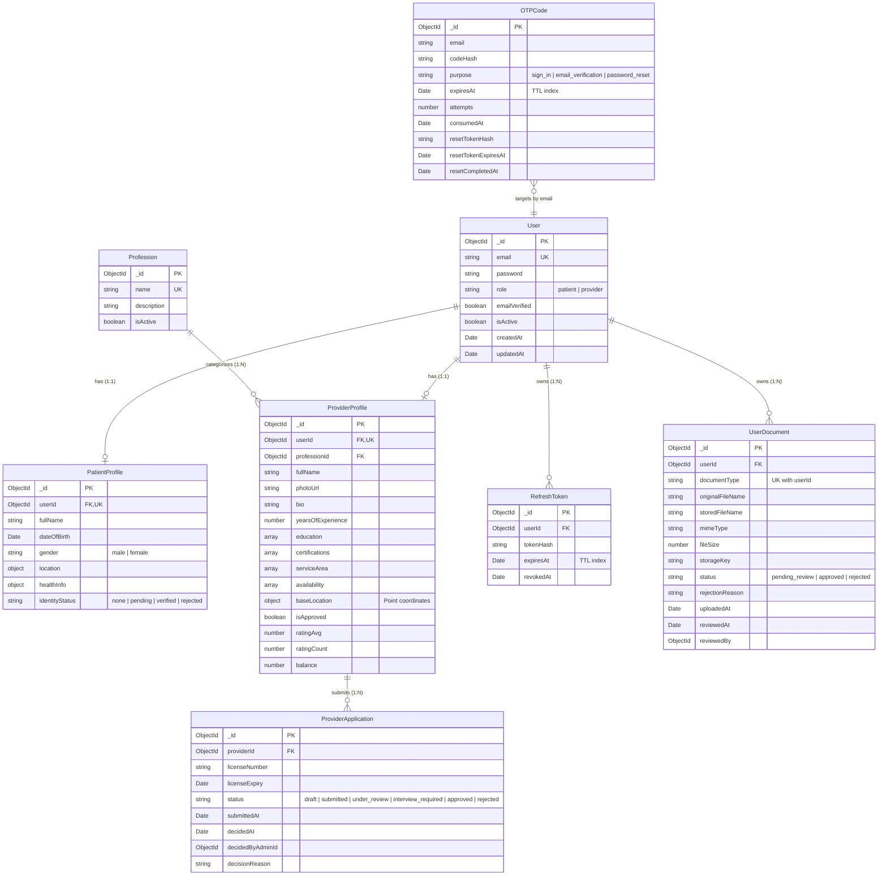

# TabibiGo Client Backend – Complete Architecture & Technical Documentation

> **Status:** Active Implementation  
> **Source of Truth:** Current Codebase (`TabibiGo_Backend`)  
> **Database:** MongoDB Atlas (`TabibiGo-Users`) via Mongoose  
> **Runtime:** Node.js, Express.js (CommonJS)

---

## 1. Project Overview

### What the Backend Does
The **TabibiGo Client Backend** is an on-demand healthcare service platform that connects **Patients** seeking home healthcare services with licensed **Healthcare Providers** (initially specializing in **Nurses** and **Physical Therapists**).

The backend delivers:
1. **User Identity & Authentication**: Role-based registration (`patient`, `provider`), email OTP verification, password hashing, JWT Access Tokens, and cryptographically secure Refresh Token rotation.
2. **Profile Management**: Profile creation, retrieval, and updating for patients and providers with active profession validation.
3. **Secure Document Management**: Private file storage outside the public web root with magic-byte/signature validation, role-based document types, separate Egyptian legal vs. platform-policy requirement distinctions, and authenticated private document streaming.
4. **Provider Verification & Application Workflow**: Provider application lifecycle (`draft`, `submitted`, `under_review`, `interview_required`, `approved`, `rejected`), ensuring profile and document readiness before submission, duplicate active application prevention, and reapplication after rejection.

### Technologies & Libraries Used
- **Node.js**: Asynchronous JavaScript runtime environment.
- **Express.js (v5.3.0)**: REST API framework.
- **Mongoose (v9.11.4)**: Object Data Modeling (ODM) for MongoDB Atlas.
- **jsonwebtoken (v9.0.3)**: Access Token generation and verification.
- **bcryptjs (v3.0.3)**: Salted password hashing (cost factor 12).
- **crypto (Node.js native)**: Secure token generation, SHA-256 hashing for refresh and reset tokens, and HMAC-SHA256 for OTP hashing.
- **nodemailer (v10.3.1)**: SMTP mail transporter for 6-digit OTP delivery.
- **express-validator (v7.3.2)**: Request body sanitization and schema validation.
- **multer (v1.4.5-lts.2)**: Multipart/form-data handler for private file uploads with disk storage.
- **cors (v2.8.6)**: Cross-Origin Resource Sharing middleware.
- **dotenv (v18.0.9)**: Environment variable loader.

### Project Architecture
The backend follows a layered MVC/Service architecture:
```
Routes ──> Middlewares (Validation, Auth, Upload) ──> Controllers ──> Services ──> Models (Mongoose) ──> MongoDB Atlas
```
- **Routes**: Expose HTTP endpoints, map HTTP methods, and chain middlewares.
- **Middlewares**: Enforce authentication (`authenticate`), role authorizations (`authorizeRoles`), input validation (`validateRequest`), and file handling/inspection (`handleDocumentUpload`).
- **Controllers**: Handle HTTP request parsing, status codes, and JSON response formatting.
- **Services**: Encapsulate all business logic, database transactions, crypto operations, and file storage tasks.
- **Models**: Define Mongoose schemas, indexes, validation rules, and collection names.

### Application Lifecycle & Startup
1. Execution starts at [src/app.js](file:///c:/Users/aehab/OneDrive/سطح%20المكتب/TabibiGo_Backend/src/app.js).
2. Environment variables are loaded using `dotenv.config()`.
3. `startServer()` calls `connectDB()` in [src/config/database.js](file:///c:/Users/aehab/OneDrive/سطح%20المكتب/TabibiGo_Backend/src/config/database.js), connecting Mongoose to MongoDB Atlas with database name `TabibiGo-Users`.
4. `seedInitialProfessions()` in [src/services/profile.service.js](file:///c:/Users/aehab/OneDrive/سطح%20المكتب/TabibiGo_Backend/src/services/profile.service.js) seeds default active professions ("Nurse" and "Physical Therapist") if not already present.
5. Global middlewares are mounted: `cors()`, `express.json()`.
6. Routes are mounted under `/api/auth`, `/api/profiles`, `/api/documents`, and `/api/provider-applications`.
7. Central 404 and global error handling middlewares are registered.
8. The Express server binds to `process.env.PORT` (or 5000).

---

## 2. Complete Project Structure

```text
TabibiGo_Backend/
├── .env                                # Environment variables (ignored by git)
├── .gitignore                          # Git ignore definitions
├── BACKEND_DOCUMENTATION.md            # Comprehensive technical documentation
├── README.md                           # Quick start and API overview
├── package.json                        # Dependencies, scripts, and metadata
├── package-lock.json                   # Dependency lockfile
├── storage/                            # Private disk storage for uploaded documents
│   └── documents/                      # Subdirectories partitioned by userId (<storage>/documents/<userId>/)
├── test_suite.js                       # Comprehensive 34-step automated integration test suite
└── src/
    ├── app.js                          # Express app configuration & server entry point
    ├── updateApplicationIndexes.js     # Index update migration utility
    ├── config/
    │   ├── database.js                 # MongoDB connection logic
    │   └── documentRequirements.js     # Document rules, categories, authorities & allowed types
    ├── controllers/
    │   ├── auth.controller.js          # Authentication, login, token refresh, logout, password reset
    │   ├── document.controller.js      # Requirements, uploads, metadata, download, deletion
    │   ├── otp.controller.js           # OTP dispatch and verification controllers
    │   ├── profile.controller.js       # Patient & provider profile CRUD & professions
    │   └── providerApplication.controller.js # Application submission & status tracking
    ├── middleware/
    │   ├── auth.middleware.js          # JWT authentication (req.user) & role authorization
    │   ├── auth.validation.js          # express-validator request schemas & error interceptor
    │   └── upload.middleware.js        # Multer disk storage, file limits, MIME & magic bytes validator
    ├── models/
    │   ├── OTPCode.js                  # OTP codes, hashes, rate-limiting & password reset tokens
    │   ├── PatientProfile.js           # Patient demographic & medical background details
    │   ├── Profession.js               # Healthcare professions catalog
    │   ├── ProviderApplication.js      # Provider credentials & verification review status
    │   ├── ProviderProfile.js          # Provider professional profile, bio, experience & ratings
    │   ├── RefreshToken.js             # Refresh token records with TTL index
    │   ├── User.js                     # Base user account, credentials & roles
    │   └── UserDocument.js             # Uploaded document metadata & verification status
    ├── routes/
    │   ├── auth.routes.js              # Auth endpoints (/api/auth)
    │   ├── document.routes.js          # Document endpoints (/api/documents)
    │   ├── profile.routes.js           # Profile endpoints (/api/profiles)
    │   └── providerApplication.routes.js # Application endpoints (/api/provider-applications)
    └── services/
        ├── auth.service.js             # User registration, login verification & password reset logic
        ├── document.service.js         # Document rules, replacement, storage retrieval & deletion
        ├── email.service.js            # Nodemailer Gmail transport
        ├── otp.service.js              # OTP generation, HMAC hashing, email dispatch & rate limits
        ├── profile.service.js          # Profile upsert, profession seeding & validation
        ├── providerApplication.service.js # Document readiness check & application submission
        └── token.service.js            # Access Token (JWT), Refresh Token rotation & revocation
```

### Detailed File Responsibilities

| File Path | Responsibility | Primary Contents | Interacts With |
|---|---|---|---|
| `src/app.js` | Express server bootstrap | Middleware setup, route registration, error handlers, server startup | `database.js`, all route files, `profile.service.js` |
| `src/config/database.js` | MongoDB connection | `connectDB()` connects Mongoose to `process.env.MONGO_URI` (`TabibiGo-Users`) | `src/app.js`, Mongoose |
| `src/config/documentRequirements.js` | Document requirements rules | `PATIENT_DOCUMENTS_CONFIG`, `PROFESSION_DOCUMENT_CONFIGS`, categories, authorities | `document.service.js`, `UserDocument.js` |
| `src/middleware/auth.middleware.js` | Authentication & authorization | `authenticate` (Bearer JWT verification), `authorizeRoles` | `User.js`, `token.service.js` |
| `src/middleware/auth.validation.js` | Input validation | Request validators for register, login, OTP, password reset, and `validateRequest` | express-validator, `auth.routes.js` |
| `src/middleware/upload.middleware.js` | Secure file uploads | Multer disk storage config, 5MB limit, MIME checks, magic byte/signature inspection | Multer, `document.routes.js` |
| `src/models/User.js` | User account schema | Email, hashed password, role (`patient`, `provider`), `emailVerified`, `isActive` | `auth.service.js`, `auth.middleware.js` |
| `src/models/PatientProfile.js` | Patient profile schema | `fullName`, `dateOfBirth`, `gender`, `location`, `healthInfo`, `identityStatus` | `profile.service.js`, `document.service.js` |
| `src/models/ProviderProfile.js` | Provider profile schema | `professionId`, `fullName`, `bio`, `yearsOfExperience`, `education`, `isApproved`, `baseLocation` | `profile.service.js`, `providerApplication.service.js` |
| `src/models/Profession.js` | Profession catalog | `name`, `description`, `isActive` | `profile.service.js`, `ProviderProfile.js` |
| `src/models/UserDocument.js` | Document metadata schema | `userId`, `documentType`, `originalFileName`, `storedFileName`, `storageKey`, `status`, `rejectionReason` | `document.service.js`, `providerApplication.service.js` |
| `src/models/ProviderApplication.js` | Provider application schema | `providerId`, `licenseNumber`, `licenseExpiry`, `status`, `decisionReason`, `submittedAt` | `providerApplication.service.js` |
| `src/models/RefreshToken.js` | Refresh token schema | `userId`, `tokenHash` (SHA-256), `expiresAt`, `revokedAt`, TTL index | `token.service.js` |
| `src/models/OTPCode.js` | OTP record schema | `email`, `codeHash`, `purpose`, `expiresAt`, `attempts`, `consumedAt`, `resetTokenHash`, TTL index | `otp.service.js`, `auth.service.js` |
| `src/services/token.service.js` | JWT & Refresh token lifecycle | `generateAccessToken`, `generateRefreshToken`, `rotateRefreshToken`, `revokeRefreshToken` | `RefreshToken.js`, `jsonwebtoken`, `crypto` |
| `src/services/auth.service.js` | Auth business logic | User creation, credential check, token generation on login, password update | `User.js`, `OTPCode.js`, `token.service.js` |
| `src/services/otp.service.js` | OTP business logic | OTP generation, HMAC hashing, email dispatch, attempt limiter, reset token generation | `OTPCode.js`, `User.js`, `email.service.js` |
| `src/services/email.service.js` | Email transport | Nodemailer Gmail transporter for OTP emails | `nodemailer`, `otp.service.js` |
| `src/services/profile.service.js` | Profile operations | `upsertPatientProfile`, `upsertProviderProfile`, profession validation, initial seeding | `PatientProfile.js`, `ProviderProfile.js`, `Profession.js` |
| `src/services/document.service.js` | Document operations | Requirements checklist, file persistence, orphan cleanup, authenticated download stream, deletion | `UserDocument.js`, `ProviderProfile.js`, `upload.middleware.js` |
| `src/services/providerApplication.service.js` | Application operations | Profession-specific document readiness check, duplicate application check, submission | `ProviderApplication.js`, `ProviderProfile.js`, `document.service.js` |
| `test_suite.js` | Automated testing | 34 automated integration tests executed against live MongoDB Atlas | `src/app.js`, all models, services, HTTP client |

---

## 3. Database Documentation

The MongoDB database is named `TabibiGo-Users`.

### Entity-Relationship Diagram



---

### Detailed Schema Specifications

#### 1. `User` (Collection: `User`)
- `_id`: `ObjectId` (Primary Key, auto-generated).
- `email`: `String`, required, unique, lowercase, trimmed.
- `password`: `String`, required if `!googleId`, hidden from queries by default (`select: false`). Hashed with `bcryptjs` (salt 12) via Mongoose `pre("save")` hook.
- `googleId`: `String`, optional, sparse unique index.
- `role`: `String`, required, enum: `["patient", "provider"]`.
- `emailVerified`: `Boolean`, default: `false`.
- `isActive`: `Boolean`, default: `true`.
- Timestamps: `createdAt`, `updatedAt`.
- Methods: `comparePassword(enteredPassword)` compares candidate text to hashed password.

#### 2. `PatientProfile` (Collection: `Patient_Profiles`)
- `_id`: `ObjectId` (Primary Key).
- `userId`: `ObjectId`, ref: `User`, required, unique.
- `fullName`: `String`, required, trimmed.
- `dateOfBirth`: `Date`, optional.
- `gender`: `String`, optional, enum: `["male", "female"]`.
- `location`: `Object`, optional:
  - `governorate`: `String`, trimmed.
  - `city`: `String`, trimmed.
  - `address`: `String`, trimmed.
- `healthInfo`: `Object`, optional:
  - `conditions`: `[String]`.
  - `allergies`: `[String]`.
  - `notes`: `String`.
- `identityStatus`: `String`, enum: `["none", "pending", "verified", "rejected"]`, default: `"none"`. (Automatically updated to `"pending"` upon uploading required identity documents).
- Timestamps: `createdAt`, `updatedAt`.

#### 3. `ProviderProfile` (Collection: `Provider_Profiles`)
- `_id`: `ObjectId` (Primary Key).
- `userId`: `ObjectId`, ref: `User`, required, unique.
- `professionId`: `ObjectId`, ref: `Profession`, required.
- `fullName`: `String`, required, trimmed.
- `photoUrl`: `String`, default: `null`.
- `bio`: `String`, trimmed.
- `yearsOfExperience`: `Number`, default: `0`, min: `0`.
- `education`: `[{ degree: String, institution: String, graduationYear: Number }]`.
- `certifications`: `[{ name: String, issuer: String, certificateUrl: String }]`.
- `serviceArea`: `[{ governorate: String, city: String }]`.
- `availability`: `[{ day: enum["saturday", "sunday", "monday", "tuesday", "wednesday", "thursday", "friday"], startTime: String, endTime: String }]`.
- `baseLocation`: GeoJSON Point schema `{ type: { type: String, enum: ["Point"] }, coordinates: [Number] }`, `default: undefined`. Indexed with `{ baseLocation: "2dsphere" }, { sparse: true }`.
- `isApproved`: `Boolean`, default: `false`.
- `ratingAvg`: `Number`, default: `0`, min: 0, max: 5.
- `ratingCount`: `Number`, default: `0`, min: 0.
- `balance`: `Number`, default: `0`.
- Timestamps: `createdAt`, `updatedAt`.

#### 4. `Profession` (Collection: `Professions`)
- `_id`: `ObjectId` (Primary Key).
- `name`: `String`, required, unique, trimmed (e.g. `"Nurse"`, `"Physical Therapist"`).
- `description`: `String`, trimmed.
- `isActive`: `Boolean`, default: `true`.
- Timestamps: `createdAt`, `updatedAt`.

#### 5. `UserDocument` (Collection: `User_Documents`)
- `_id`: `ObjectId` (Primary Key).
- `userId`: `ObjectId`, ref: `User`, required, indexed.
- `documentType`: `String`, required, enum of allowed types (including multi-file types like `experience_certificate` and `additional_training_certificate`).
- `originalFileName`: `String`, required, trimmed (e.g., `license.pdf`).
- `storedFileName`: `String`, required, trimmed (random unique name on disk).
- `mimeType`: `String`, required, trimmed (`image/jpeg`, `image/png`, `image/webp`, `application/pdf`).
- `fileSize`: `Number`, required, min: 0 (bytes).
- `storageKey`: `String`, required, trimmed (absolute path to private disk file).
- `status`: `String`, enum: `["pending_review", "approved", "rejected"]`, default: `"pending_review"`.
- `rejectionReason`: `String`, default: `null`.
- `isActiveVersion`: `Boolean`, default: `true`, indexed. Marks the current active document record in review.
- `version`: `Number`, default: `1`. Incremented on each replacement.
- `previousDocumentId`: `ObjectId`, ref: `UserDocument`, default: `null`. Links a replacement document to its superseded predecessor.
- `uploadedAt`: `Date`, default: `Date.now`.
- `reviewedAt`: `Date`, default: `null`.
- `reviewedBy`: `String`, default: `null`.
- Indexes:
  - `{ userId: 1, documentType: 1, isActiveVersion: 1 }` (Non-unique, enables fast active document lookup while supporting multiple files and version history).
  - `{ userId: 1, uploadedAt: -1 }` (Timeline ordering).
- Timestamps: `createdAt`, `updatedAt`.

#### 9. `ProviderVerification` (Collection: `Provider_Verifications`)
- `_id`: `ObjectId` (Primary Key).
- `providerId`: `ObjectId`, ref: `ProviderProfile`, required, unique.
- `userId`: `ObjectId`, ref: `User`, required, unique.
- `identityVerification`: Stage sub-document:
  - `status`: String, enum: `["not_started", "pending", "under_review", "verified", "rejected", "requires_action"]`, default: `"not_started"`.
  - `reviewNotes`: String, default: null.
  - `rejectionReason`: String, default: null.
  - `reviewedBy`: String, default: null.
  - `reviewedAt`: Date, default: null.
  - `verificationMethod`: String (e.g. `"manual_document_review"`).
  - `supportingDocumentIds`: `[ObjectId]` ref `UserDocument`.
- `licenseVerification`: Stage sub-document (same schema as above).
- `experienceVerification`: Stage sub-document (same schema as above).
- `skillsAssessment`: Stage sub-document (same schema as above).
- `overallStatus`: String, enum: `["unverified", "in_progress", "verified", "rejected"]`, default: `"unverified"`.
- Timestamps: `createdAt`, `updatedAt`.

#### 10. `DocumentAuditLog` (Collection: `Document_Audit_Logs`)
- `_id`: `ObjectId` (Primary Key).
- `targetType`: String, enum: `["document", "verification_stage", "application"]`.
- `targetId`: `ObjectId`, required, indexed.
- `userId`: `ObjectId`, ref: `User`, required, indexed.
- `action`: String, enum: `["document_uploaded", "document_replaced", "document_approved", "document_rejected", "verification_stage_updated", "application_submitted", "application_approved", "application_rejected", "application_interview_scheduled"]`.
- `previousStatus`: String, default: null.
- `newStatus`: String, default: null.
- `actorType`: String, enum: `["user", "admin", "system"]`.
- `actorId`: String, required (e.g., admin email or userId).
- `reason`: String, default: null.
- `metadata`: Object, default: `{}`.
- `timestamp`: Date, default: `Date.now`, indexed.

#### 6. `ProviderApplication` (Collection: `Provider_Applications`)
- `_id`: `ObjectId` (Primary Key).
- `providerId`: `ObjectId`, ref: `ProviderProfile`, required.
- `licenseNumber`: `String`, required, trimmed.
- `licenseExpiry`: `Date`, required.
- `status`: `String`, enum: `["draft", "submitted", "under_review", "interview_required", "approved", "rejected"]`, default: `"draft"`.
- `submittedAt`: `Date`, default: `null`.
- `decidedAt`: `Date`, default: `null`.
- `decidedByAdminId`: `ObjectId`, default: `null`.
- `decisionReason`: `String`, default: `null`.
- Indexes: `{ providerId: 1, createdAt: -1 }`.
- Timestamps: `createdAt`, `updatedAt`.

#### 7. `RefreshToken` (Collection: `Refresh_Tokens`)
- `_id`: `ObjectId` (Primary Key).
- `userId`: `ObjectId`, ref: `User`, required.
- `tokenHash`: `String`, required, SHA-256 hash of the plain random token, `select: false`.
- `expiresAt`: `Date`, required.
- `revokedAt`: `Date`, default: `null`.
- Indexes: `{ expiresAt: 1 }, { expireAfterSeconds: 0 }` (MongoDB TTL index).
- Timestamps: `createdAt`, `updatedAt`.

#### 8. `OTPCode` (Collection: `Otp_Codes`)
- `_id`: `ObjectId` (Primary Key).
- `email`: `String`, required, lowercase, trimmed.
- `codeHash`: `String`, required, HMAC-SHA256 hash using `process.env.OTP_SECRET`, `select: false`.
- `purpose`: `String`, required, enum: `["sign_in", "email_verification", "password_reset"]`.
  > **Note:** Only `email_verification` and `password_reset` are implemented in routes. `sign_in` is a reserved schema enum value; passwordless OTP sign-in is **Not Implemented**.
- `expiresAt`: `Date`, required.
- `attempts`: `Number`, default: `0`, min: 0 (locked at 5 failed attempts).
- `consumedAt`: `Date`, default: `null`.
- `resetTokenHash`: `String`, SHA-256 hash of password reset token, `select: false`.
- `resetTokenExpiresAt`: `Date`, default: `null`.
- `resetCompletedAt`: `Date`, default: `null`.
- Indexes: `{ expiresAt: 1 }, { expireAfterSeconds: 0 }` (MongoDB TTL index).
- Timestamps: `createdAt`, `updatedAt`.

---

## 4. Complete API Reference

Base URL: `http://localhost:5000` (or `http://127.0.0.1:<PORT>`)

---

### Authentication Endpoints (`/api/auth`)

#### 1. Register User
- **Method:** `POST`
- **URL:** `/api/auth/register`
- **Purpose:** Create a new user account with role `patient` or `provider`.
- **Authentication:** Not Required.
- **Authorization:** Public.
- **Headers:** `Content-Type: application/json`
- **Request Body:**
  ```json
  {
    "email": "user@example.com",
    "password": "Password123",
    "role": "patient"
  }
  ```
  - `email`: String, required, valid email format.
  - `password`: String, required, min 8 chars, 1 uppercase, 1 lowercase, 1 number.
  - `role`: String, required, must be `"patient"` or `"provider"`.
- **Success Response (201 Created):**
  ```json
  {
    "success": true,
    "message": "Account created successfully. Please verify your email.",
    "data": {
      "user": {
        "id": "673f4e24a8b123456789abcd",
        "email": "user@example.com",
        "role": "patient",
        "emailVerified": false
      }
    }
  }
  ```
- **Error Responses:**
  - `400 Bad Request`: Validation failure (weak password, invalid email, or invalid role).
  - `409 Conflict`: `"Email is already registered."`
- **Files Involved:** `src/routes/auth.routes.js`, `src/middleware/auth.validation.js`, `src/controllers/auth.controller.js`, `src/services/auth.service.js`, `src/models/User.js`.

---

#### 2. Send Email Verification OTP
- **Method:** `POST`
- **URL:** `/api/auth/send-verification-otp`
- **Purpose:** Generate and email a 6-digit OTP code to verify user email.
- **Authentication:** Not Required.
- **Authorization:** Public.
- **Headers:** `Content-Type: application/json`
- **Request Body:**
  ```json
  {
    "email": "user@example.com"
  }
  ```
- **Success Response (200 OK):**
  ```json
  {
    "success": true,
    "message": "Verification OTP sent successfully."
  }
  ```
- **Error Responses:**
  - `404 Not Found`: `"User not found."`
  - `409 Conflict`: `"Email is already verified."`
  - `429 Too Many Requests`: `"Please wait 60 seconds before requesting another OTP."`
  - `502 Bad Gateway`: `"Failed to send verification email."` (SMTP failure).
- **Files Involved:** `src/routes/auth.routes.js`, `src/controllers/otp.controller.js`, `src/services/otp.service.js`, `src/services/email.service.js`, `src/models/OTPCode.js`.

---

#### 3. Verify Email with OTP
- **Method:** `POST`
- **URL:** `/api/auth/verify-email`
- **Purpose:** Validate submitted 6-digit OTP and mark user account as `emailVerified: true`.
- **Authentication:** Not Required.
- **Authorization:** Public.
- **Headers:** `Content-Type: application/json`
- **Request Body:**
  ```json
  {
    "email": "user@example.com",
    "code": "123456"
  }
  ```
  - `code`: String, required, exactly 6 digits (`/^\d{6}$/`).
- **Success Response (200 OK):**
  ```json
  {
    "success": true,
    "message": "Email verified successfully."
  }
  ```
- **Error Responses:**
  - `400 Bad Request`: `"Invalid or expired OTP."` / `"Incorrect OTP."` / `"OTP has expired."`
  - `404 Not Found`: `"User not found."`
  - `409 Conflict`: `"Email is already verified."`
  - `429 Too Many Requests`: `"Maximum OTP attempts exceeded."` (after 5 failed attempts).
- **Files Involved:** `src/routes/auth.routes.js`, `src/middleware/auth.validation.js`, `src/controllers/otp.controller.js`, `src/services/otp.service.js`, `src/models/User.js`, `src/models/OTPCode.js`.

---

#### 4. Login User
- **Method:** `POST`
- **URL:** `/api/auth/login`
- **Purpose:** Authenticate credentials, check email verification status and active state, and issue JWT Access Token and Refresh Token.
- **Authentication:** Not Required.
- **Authorization:** Public.
- **Headers:** `Content-Type: application/json`
- **Request Body:**
  ```json
  {
    "email": "user@example.com",
    "password": "Password123"
  }
  ```
- **Success Response (200 OK):**
  ```json
  {
    "success": true,
    "message": "Login successful.",
    "data": {
      "user": {
        "id": "673f4e24a8b123456789abcd",
        "email": "user@example.com",
        "role": "patient",
        "emailVerified": true
      },
      "tokens": {
        "accessToken": "eyJhbGciOiJIUzI1NiIsInR5cCI6IkpXVCJ9...",
        "refreshToken": "4a7b9c1d2e3f..."
      }
    }
  }
  ```
- **Error Responses:**
  - `401 Unauthorized`: `"Invalid email or password."`
  - `403 Forbidden`: `"Please verify your email first."`
  - `403 Forbidden`: `"Your account is inactive."`
- **Files Involved:** `src/routes/auth.routes.js`, `src/middleware/auth.validation.js`, `src/controllers/auth.controller.js`, `src/services/auth.service.js`, `src/services/token.service.js`, `src/models/User.js`, `src/models/RefreshToken.js`.

---

#### 5. Refresh Authentication Token
- **Method:** `POST`
- **URL:** `/api/auth/refresh-token`
- **Purpose:** Rotate an existing refresh token: revokes the old token and issues a new access token and new refresh token.
- **Authentication:** Not Required (authenticated via refresh token body).
- **Authorization:** Public.
- **Headers:** `Content-Type: application/json`
- **Request Body:**
  ```json
  {
    "refreshToken": "4a7b9c1d2e3f..."
  }
  ```
- **Success Response (200 OK):**
  ```json
  {
    "success": true,
    "message": "Token refreshed successfully.",
    "data": {
      "accessToken": "eyJhbGciOiJIUzI1NiIsInR5cCI6IkpXVCJ9...",
      "refreshToken": "9f8e7d6c5b4a...",
      "user": {
        "id": "673f4e24a8b123456789abcd",
        "email": "user@example.com",
        "role": "patient",
        "emailVerified": true
      }
    }
  }
  ```
- **Error Responses:**
  - `400 Bad Request`: `"Refresh token is required."`
  - `401 Unauthorized`: `"Invalid or expired refresh token."`
  - `403 Forbidden`: `"Your account is inactive."`
- **Files Involved:** `src/routes/auth.routes.js`, `src/controllers/auth.controller.js`, `src/services/token.service.js`, `src/models/RefreshToken.js`.

---

#### 6. Logout User
- **Method:** `POST`
- **URL:** `/api/auth/logout`
- **Purpose:** Invalidate and revoke an active refresh token.
- **Authentication:** Not Required.
- **Authorization:** Public.
- **Headers:** `Content-Type: application/json`
- **Request Body:**
  ```json
  {
    "refreshToken": "4a7b9c1d2e3f..."
  }
  ```
- **Success Response (200 OK):**
  ```json
  {
    "success": true,
    "message": "Logged out successfully."
  }
  ```
- **Files Involved:** `src/routes/auth.routes.js`, `src/controllers/auth.controller.js`, `src/services/token.service.js`, `src/models/RefreshToken.js`.

---

#### 7. Get Current User Details
- **Method:** `GET`
- **URL:** `/api/auth/me`
- **Purpose:** Validate Bearer token and retrieve the logged-in user's account details.
- **Authentication:** Required.
- **Authorization:** Authenticated User (`patient` or `provider`).
- **Headers:**
  ```http
  Authorization: Bearer <access_token>
  ```
- **Success Response (200 OK):**
  ```json
  {
    "success": true,
    "message": "User profile retrieved successfully.",
    "data": {
      "user": {
        "id": "673f4e24a8b123456789abcd",
        "email": "user@example.com",
        "role": "patient",
        "emailVerified": true,
        "isActive": true,
        "createdAt": "2026-11-23T20:00:00.000Z"
      }
    }
  }
  ```
- **Error Responses:**
  - `401 Unauthorized`: `"Authentication token missing or invalid format."` / `"Invalid authentication token."` / `"Authentication token expired."`
  - `403 Forbidden`: `"User account is inactive."` / `"Please verify your email address."`
- **Files Involved:** `src/routes/auth.routes.js`, `src/middleware/auth.middleware.js`, `src/controllers/auth.controller.js`.

---

#### 8. Forgot Password
- **Method:** `POST`
- **URL:** `/api/auth/forgot-password`
- **Purpose:** Send a 6-digit password reset OTP to user's registered email.
- **Authentication:** Not Required.
- **Authorization:** Public.
- **Headers:** `Content-Type: application/json`
- **Request Body:**
  ```json
  {
    "email": "user@example.com"
  }
  ```
- **Success Response (200 OK):**
  ```json
  {
    "success": true,
    "message": "Password reset OTP sent successfully."
  }
  ```
- **Files Involved:** `src/routes/auth.routes.js`, `src/middleware/auth.validation.js`, `src/controllers/otp.controller.js`, `src/services/otp.service.js`.

---

#### 9. Verify Password Reset OTP
- **Method:** `POST`
- **URL:** `/api/auth/verify-password-reset`
- **Purpose:** Verify password reset OTP and receive a one-time 64-character hexadecimal `resetToken`.
- **Authentication:** Not Required.
- **Authorization:** Public.
- **Headers:** `Content-Type: application/json`
- **Request Body:**
  ```json
  {
    "email": "user@example.com",
    "code": "123456"
  }
  ```
- **Success Response (200 OK):**
  ```json
  {
    "success": true,
    "message": "OTP verified successfully.",
    "data": {
      "resetToken": "a1b2c3d4e5f60718293a4b5c6d7e8f90a1b2c3d4e5f60718293a4b5c6d7e8f90"
    }
  }
  ```
- **Files Involved:** `src/routes/auth.routes.js`, `src/middleware/auth.validation.js`, `src/controllers/otp.controller.js`, `src/services/otp.service.js`.

---

#### 10. Reset Password
- **Method:** `POST`
- **URL:** `/api/auth/reset-password`
- **Purpose:** Update user password using validated `resetToken`.
- **Authentication:** Not Required.
- **Authorization:** Public.
- **Headers:** `Content-Type: application/json`
- **Request Body:**
  ```json
  {
    "resetToken": "a1b2c3d4e5f60718293a4b5c6d7e8f90a1b2c3d4e5f60718293a4b5c6d7e8f90",
    "newPassword": "NewStrongPassword1"
  }
  ```
- **Success Response (200 OK):**
  ```json
  {
    "success": true,
    "message": "Password reset successfully."
  }
  ```
- **Error Responses:**
  - `400 Bad Request`: `"Invalid or expired reset token."`
  - `404 Not Found`: `"User not found."`
- **Files Involved:** `src/routes/auth.routes.js`, `src/middleware/auth.validation.js`, `src/controllers/auth.controller.js`, `src/services/auth.service.js`.

---

### Profile Endpoints (`/api/profiles`)

#### 11. List Active Professions
- **Method:** `GET`
- **URL:** `/api/profiles/professions`
- **Purpose:** List all active healthcare professions available on TabibiGo.
- **Authentication:** Not Required.
- **Authorization:** Public.
- **Success Response (200 OK):**
  ```json
  {
    "success": true,
    "message": "Professions retrieved successfully.",
    "data": {
      "professions": [
        {
          "_id": "673f4e24a8b1234567891111",
          "name": "Nurse",
          "description": "Registered or licensed nurse providing care"
        },
        {
          "_id": "673f4e24a8b1234567892222",
          "name": "Physical Therapist",
          "description": "Licensed physical therapy specialist"
        }
      ]
    }
  }
  ```
- **Files Involved:** `src/routes/profile.routes.js`, `src/controllers/profile.controller.js`, `src/services/profile.service.js`, `src/models/Profession.js`.

---

#### 12. Complete / Upsert Patient Profile
- **Method:** `POST`
- **URL:** `/api/profiles/patient`
- **Purpose:** Create or complete the authenticated patient's profile.
- **Authentication:** Required.
- **Authorization:** `patient` role only.
- **Headers:**
  ```http
  Content-Type: application/json
  Authorization: Bearer <access_token>
  ```
- **Request Body:**
  ```json
  {
    "fullName": "Ahmed Mohamed",
    "dateOfBirth": "1990-01-15",
    "gender": "male",
    "location": {
      "governorate": "Cairo",
      "city": "Nasr City",
      "address": "15 Tayaran Street"
    },
    "healthInfo": {
      "conditions": ["Diabetes Type 2"],
      "allergies": ["Penicillin"],
      "notes": "Prefers morning home visits"
    }
  }
  ```
  - `fullName`: String, required.
  - `dateOfBirth`: String/Date, optional.
  - `gender`: String, optional (`"male"`, `"female"`).
  - `location`: Object, optional.
  - `healthInfo`: Object, optional.
- **Success Response (200 OK):**
  ```json
  {
    "success": true,
    "message": "Patient profile saved successfully.",
    "data": {
      "profile": {
        "_id": "673f4e24a8b1234567893333",
        "userId": "673f4e24a8b123456789abcd",
        "fullName": "Ahmed Mohamed",
        "dateOfBirth": "1990-01-15T00:00:00.000Z",
        "gender": "male",
        "identityStatus": "none",
        "location": {
          "governorate": "Cairo",
          "city": "Nasr City",
          "address": "15 Tayaran Street"
        },
        "healthInfo": {
          "conditions": ["Diabetes Type 2"],
          "allergies": ["Penicillin"],
          "notes": "Prefers morning home visits"
        }
      }
    }
  }
  ```
- **Error Responses:**
  - `400 Bad Request`: `"Full name is required."`
  - `403 Forbidden`: `"Only patients can complete a patient profile."` / `"Access forbidden: insufficient permissions."`
- **Files Involved:** `src/routes/profile.routes.js`, `src/middleware/auth.middleware.js`, `src/controllers/profile.controller.js`, `src/services/profile.service.js`, `src/models/PatientProfile.js`.

---

#### 13. Complete / Upsert Provider Profile
- **Method:** `POST`
- **URL:** `/api/profiles/provider`
- **Purpose:** Create or complete the authenticated provider's profile, linked to an active `Profession`.
- **Authentication:** Required.
- **Authorization:** `provider` role only.
- **Headers:**
  ```http
  Content-Type: application/json
  Authorization: Bearer <access_token>
  ```
- **Request Body:**
  ```json
  {
    "fullName": "Sara Ibrahim",
    "professionId": "673f4e24a8b1234567891111",
    "bio": "Certified Intensive Care Nurse with 6 years experience.",
    "yearsOfExperience": 6,
    "education": [
      {
        "degree": "Bachelor of Nursing",
        "institution": "Cairo University",
        "graduationYear": 2018
      }
    ]
  }
  ```
  - `fullName`: String, required for new profiles.
  - `professionId`: ObjectId string, required for new profiles; must match an active Profession in MongoDB.
  - `yearsOfExperience`: Number, optional.
  - `bio`: String, optional.
  - `education`, `certifications`, `serviceArea`, `availability`: Array, optional.
- **Success Response (200 OK):**
  ```json
  {
    "success": true,
    "message": "Provider profile saved successfully.",
    "data": {
      "profile": {
        "_id": "673f4e24a8b1234567894444",
        "userId": "673f4e24a8b123456789cdef",
        "fullName": "Sara Ibrahim",
        "professionId": {
          "_id": "673f4e24a8b1234567891111",
          "name": "Nurse",
          "description": "Registered or licensed nurse providing care"
        },
        "bio": "Certified Intensive Care Nurse with 6 years experience.",
        "yearsOfExperience": 6,
        "isApproved": false,
        "ratingAvg": 0,
        "ratingCount": 0,
        "balance": 0
      }
    }
  }
  ```
- **Error Responses:**
  - `400 Bad Request`: `"Invalid or inactive profession selected."` / `"Profession ID is required."` / `"Full name is required."`
  - `403 Forbidden`: `"Only providers can complete a provider profile."`
- **Files Involved:** `src/routes/profile.routes.js`, `src/middleware/auth.middleware.js`, `src/controllers/profile.controller.js`, `src/services/profile.service.js`, `src/models/ProviderProfile.js`, `src/models/Profession.js`.

---

#### 14. Get My Profile
- **Method:** `GET`
- **URL:** `/api/profiles/me`
- **Purpose:** Retrieve the full profile of the logged-in patient or provider.
- **Authentication:** Required.
- **Authorization:** Authenticated User (`patient` or `provider`).
- **Headers:**
  ```http
  Authorization: Bearer <access_token>
  ```
- **Success Response (200 OK):**
  ```json
  {
    "success": true,
    "message": "Profile retrieved successfully.",
    "data": {
      "role": "patient",
      "user": {
        "id": "673f4e24a8b123456789abcd",
        "email": "user@example.com",
        "emailVerified": true
      },
      "profile": {
        "_id": "673f4e24a8b1234567893333",
        "userId": "673f4e24a8b123456789abcd",
        "fullName": "Ahmed Mohamed",
        "identityStatus": "none"
      }
    }
  }
  ```
- **Error Responses:**
  - `404 Not Found`: `"Profile not found. Please complete your profile first."`
- **Files Involved:** `src/routes/profile.routes.js`, `src/middleware/auth.middleware.js`, `src/controllers/profile.controller.js`, `src/services/profile.service.js`.

---

#### 15. Update My Profile
- **Method:** `PUT`
- **URL:** `/api/profiles/me`
- **Purpose:** Update fields of the authenticated patient or provider's profile.
- **Authentication:** Required.
- **Authorization:** Authenticated User.
- **Headers:**
  ```http
  Content-Type: application/json
  Authorization: Bearer <access_token>
  ```
- **Request Body (Patient example):**
  ```json
  {
    "fullName": "Ahmed M. Ali",
    "location": {
      "governorate": "Giza",
      "city": "Dokki"
    }
  }
  ```
- **Success Response (200 OK):**
  ```json
  {
    "success": true,
    "message": "Profile updated successfully.",
    "data": {
      "profile": { ... }
    }
  }
  ```
- **Files Involved:** `src/routes/profile.routes.js`, `src/controllers/profile.controller.js`, `src/services/profile.service.js`.

---

### Document Endpoints (`/api/documents`)

#### 16. Get Required Documents Status
- **Method:** `GET`
- **URL:** `/api/documents/requirements`
- **Purpose:** Retrieve the list of required documents for the authenticated user based on role and profession, showing dynamic status (`missing`, `pending_review`, `approved`, `rejected`), category (`legal_mandatory` vs `platform_policy`), and issuing authority.
- **Authentication:** Required.
- **Authorization:** Authenticated User (`patient` or `provider`).
- **Headers:**
  ```http
  Authorization: Bearer <access_token>
  ```
- **Success Response (Provider - Nurse example) (200 OK):**
  ```json
  {
    "success": true,
    "message": "Required documents retrieved successfully.",
    "data": {
      "requirements": [
        {
          "documentType": "nursing_graduation_certificate",
          "legacyType": "graduation_certificate",
          "label": "Nursing Graduation Certificate",
          "category": "legal_mandatory",
          "authority": "Accredited University / Technical Institute of Nursing",
          "required": true,
          "description": "Official Bachelor of Nursing or Nursing Institute graduation certificate.",
          "isUploaded": true,
          "status": "pending_review",
          "documentId": "673f4e24a8b1234567895555",
          "uploadedAt": "2026-11-23T20:30:00.000Z",
          "rejectionReason": null
        },
        {
          "documentType": "nursing_practice_license",
          "legacyType": "professional_license",
          "label": "Valid Nursing Professional Practice License",
          "category": "legal_mandatory",
          "authority": "Egyptian Ministry of Health and Population (MOHP)",
          "required": true,
          "description": "MOHP License to practice nursing in the Arab Republic of Egypt.",
          "isUploaded": false,
          "status": "missing",
          "documentId": null,
          "uploadedAt": null,
          "rejectionReason": null
        },
        {
          "documentType": "nursing_syndicate_card",
          "legacyType": "syndicate_card",
          "label": "Nursing Syndicate Membership Card",
          "category": "legal_mandatory",
          "authority": "Egyptian Syndicate of Nursing",
          "required": true,
          "description": "Valid membership card or official membership evidence from the Egyptian Nursing Syndicate.",
          "isUploaded": false,
          "status": "missing",
          "documentId": null,
          "uploadedAt": null,
          "rejectionReason": null
        },
        {
          "documentType": "bls_certificate",
          "legacyType": "bls_certificate",
          "label": "Basic Life Support (BLS) Certificate",
          "category": "platform_policy",
          "authority": "Accredited Provider (e.g. AHA, ERC, Egyptian Resuscitation Council)",
          "required": true,
          "description": "Valid BLS/CPR certification as required by TabibiGo patient safety policy.",
          "isUploaded": false,
          "status": "missing",
          "documentId": null,
          "uploadedAt": null,
          "rejectionReason": null
        },
        {
          "documentType": "national_id_front",
          "legacyType": "national_id_front",
          "label": "National ID – Front",
          "category": "platform_policy",
          "authority": "Civil Registry of Egypt",
          "required": true,
          "description": "Valid Egyptian National ID front side for identity verification.",
          "isUploaded": false,
          "status": "missing",
          "documentId": null,
          "uploadedAt": null,
          "rejectionReason": null
        },
        {
          "documentType": "national_id_back",
          "legacyType": "national_id_back",
          "label": "National ID – Back",
          "category": "platform_policy",
          "authority": "Civil Registry of Egypt",
          "required": true,
          "description": "Valid Egyptian National ID back side.",
          "isUploaded": false,
          "status": "missing",
          "documentId": null,
          "uploadedAt": null,
          "rejectionReason": null
        }
      ]
    }
  }
  ```
- **Files Involved:** `src/routes/document.routes.js`, `src/controllers/document.controller.js`, `src/services/document.service.js`, `src/config/documentRequirements.js`.

---

#### 17. Upload or Replace Document
- **Method:** `POST`
- **URL:** `/api/documents/upload`
- **Purpose:** Securely upload or overwrite a document for the authenticated user. Enforces MIME checks, extension checks, magic-byte inspection, role-based restrictions, and 5MB size limit.
- **Authentication:** Required.
- **Authorization:** Authenticated User (`patient` or `provider`).
- **Headers:**
  ```http
  Authorization: Bearer <access_token>
  Content-Type: multipart/form-data (let HTTP client generate boundary)
  ```
- **Form Fields:**
  - `documentType` (text, required): Target document type (e.g. `"nursing_practice_license"`, `"national_id_front"`).
  - `file` (binary, required): Single file (JPEG, PNG, WebP, or PDF, max 5 MB).
- **Success Response (201 Created):**
  ```json
  {
    "success": true,
    "message": "Document uploaded successfully.",
    "data": {
      "document": {
        "id": "673f4e24a8b1234567895555",
        "documentType": "nursing_practice_license",
        "originalFileName": "nurse_license_2026.pdf",
        "mimeType": "application/pdf",
        "fileSize": 142500,
        "status": "pending_review",
        "uploadedAt": "2026-11-23T20:35:00.000Z"
      }
    }
  }
  ```
- **Error Responses:**
  - `400 Bad Request`: `"documentType is required."`
  - `400 Bad Request`: `"Document type '...' is not valid for role '...'."`
  - `400 Bad Request`: `"File type .exe or MIME application/x-msdownload is not allowed."`
  - `400 Bad Request`: `"File signature mismatch. The file content does not match its extension/MIME type."`
  - `400 Bad Request`: `"File exceeds maximum allowed size of 5MB."`
- **Files Involved:** `src/routes/document.routes.js`, `src/middleware/upload.middleware.js`, `src/controllers/document.controller.js`, `src/services/document.service.js`, `src/models/UserDocument.js`.

---

#### 18. List My Uploaded Documents
- **Method:** `GET`
- **URL:** `/api/documents/my-documents`
- **Purpose:** Retrieve metadata of all documents uploaded by the authenticated user. Excludes internal disk paths (`storageKey`).
- **Authentication:** Required.
- **Authorization:** Authenticated User.
- **Headers:**
  ```http
  Authorization: Bearer <access_token>
  ```
- **Success Response (200 OK):**
  ```json
  {
    "success": true,
    "message": "Documents retrieved successfully.",
    "data": {
      "documents": [
        {
          "_id": "673f4e24a8b1234567895555",
          "userId": "673f4e24a8b123456789cdef",
          "documentType": "nursing_practice_license",
          "originalFileName": "nurse_license_2026.pdf",
          "storedFileName": "1732400000000-a1b2c3d4e5f6.pdf",
          "mimeType": "application/pdf",
          "fileSize": 142500,
          "status": "pending_review",
          "rejectionReason": null,
          "uploadedAt": "2026-11-23T20:35:00.000Z"
        }
      ]
    }
  }
  ```
- **Files Involved:** `src/routes/document.routes.js`, `src/controllers/document.controller.js`, `src/services/document.service.js`.

---

#### 19. Get Document Metadata
- **Method:** `GET`
- **URL:** `/api/documents/:documentId`
- **Purpose:** Retrieve metadata for a specific document owned by the authenticated user.
- **Authentication:** Required.
- **Authorization:** Document Owner only.
- **Path Parameters:** `documentId` (MongoDB ObjectId).
- **Success Response (200 OK):**
  ```json
  {
    "success": true,
    "message": "Document metadata retrieved successfully.",
    "data": {
      "document": {
        "id": "673f4e24a8b1234567895555",
        "documentType": "nursing_practice_license",
        "originalFileName": "nurse_license_2026.pdf",
        "mimeType": "application/pdf",
        "fileSize": 142500,
        "status": "pending_review",
        "rejectionReason": null,
        "uploadedAt": "2026-11-23T20:35:00.000Z",
        "reviewedAt": null
      }
    }
  }
  ```
- **Error Responses:**
  - `404 Not Found`: `"Document not found or access denied."`
- **Files Involved:** `src/routes/document.routes.js`, `src/controllers/document.controller.js`, `src/services/document.service.js`.

---

#### 20. Private Authenticated Document Download / Stream
- **Method:** `GET`
- **URL:** `/api/documents/:documentId/download`
- **Purpose:** Securely stream or view the private file binary.
- **Authentication:** Required.
- **Authorization:** Document Owner only (`req.user._id === document.userId`).
  > **Important Audit Note:** Administrative reviewers currently have **No Implemented Endpoint** in the Client Backend to view or stream private user documents. Admin access must be provided through a dedicated internal service-to-service API.
- **Headers:**
  ```http
  Authorization: Bearer <access_token>
  ```
- **Path Parameters:** `documentId` (MongoDB ObjectId).
- **Success Response (200 OK):**
  - Binary file stream.
  - Response headers:
    ```http
    Content-Type: <file_mime_type>
    Content-Disposition: inline; filename="<original_filename>"
    ```
- **Error Responses:**
  - `404 Not Found`: `"Document not found or access denied."`
  - `404 Not Found`: `"Document file is missing from storage."`
- **Files Involved:** `src/routes/document.routes.js`, `src/controllers/document.controller.js`, `src/services/document.service.js`.

---

#### 21. Delete Document
- **Method:** `DELETE`
- **URL:** `/api/documents/:documentId`
- **Purpose:** Delete a document and its underlying physical file from disk. Permitted only if document is in `pending_review` or `rejected` status.
- **Authentication:** Required.
- **Authorization:** Document Owner only.
- **Path Parameters:** `documentId` (MongoDB ObjectId).
- **Success Response (200 OK):**
  ```json
  {
    "success": true,
    "message": "Document deleted successfully."
  }
  ```
- **Error Responses:**
  - `400 Bad Request`: `"Approved documents cannot be deleted."`
  - `404 Not Found`: `"Document not found or access denied."`
- **Files Involved:** `src/routes/document.routes.js`, `src/controllers/document.controller.js`, `src/services/document.service.js`.

---

### Provider Application Endpoints (`/api/provider-applications`)

#### 22. Get Provider Application Status
- **Method:** `GET`
- **URL:** `/api/provider-applications/status`
- **Purpose:** Retrieve the provider's active or latest application and approval state.
- **Authentication:** Required.
- **Authorization:** `provider` role only.
- **Headers:**
  ```http
  Authorization: Bearer <access_token>
  ```
- **Success Response (200 OK):**
  ```json
  {
    "success": true,
    "message": "Application status retrieved successfully.",
    "data": {
      "provider": {
        "_id": "673f4e24a8b1234567894444",
        "fullName": "Sara Ibrahim",
        "isApproved": false
      },
      "application": {
        "_id": "673f4e24a8b1234567896666",
        "providerId": "673f4e24a8b1234567894444",
        "licenseNumber": "NUR-98765-EG",
        "licenseExpiry": "2029-12-31T00:00:00.000Z",
        "status": "submitted",
        "submittedAt": "2026-11-23T20:40:00.000Z",
        "decisionReason": null
      }
    }
  }
  ```
- **Error Responses:**
  - `404 Not Found`: `"Provider profile not found."`
- **Files Involved:** `src/routes/providerApplication.routes.js`, `src/controllers/providerApplication.controller.js`, `src/services/providerApplication.service.js`.

---

#### 23. Submit Provider Application
- **Method:** `POST`
- **URL:** `/api/provider-applications/submit`
- **Purpose:** Submit application for platform verification. Enforces that all required profession-specific documents are uploaded and none are rejected.
- **Authentication:** Required.
- **Authorization:** `provider` role only.
- **Headers:**
  ```http
  Content-Type: application/json
  Authorization: Bearer <access_token>
  ```
- **Request Body:**
  ```json
  {
    "licenseNumber": "NUR-98765-EG",
    "licenseExpiry": "2029-12-31"
  }
  ```
  - `licenseNumber`: String, required.
  - `licenseExpiry`: Date string, required, valid date.
- **Success Response (201 Created):**
  ```json
  {
    "success": true,
    "message": "Provider application submitted successfully.",
    "data": {
      "application": {
        "_id": "673f4e24a8b1234567896666",
        "providerId": "673f4e24a8b1234567894444",
        "licenseNumber": "NUR-98765-EG",
        "licenseExpiry": "2029-12-31T00:00:00.000Z",
        "status": "submitted",
        "submittedAt": "2026-11-23T20:40:00.000Z"
      }
    }
  }
  ```
- **Error Responses:**
  - `400 Bad Request`: `"License number and expiry date are required."`
  - `400 Bad Request`: `"Cannot submit application: Missing required documents: [Nursing Practice License (nursing_practice_license)]."`
  - `404 Not Found`: `"Provider profile not found. Please complete your profile first."`
  - `409 Conflict`: `"This provider is already approved."`
  - `409 Conflict`: `"You already have an active or approved application."`
- **Files Involved:** `src/routes/providerApplication.routes.js`, `src/controllers/providerApplication.controller.js`, `src/services/providerApplication.service.js`, `src/models/ProviderApplication.js`.

---

## 5. Authentication Workflow

```
[Register] ──> [Send OTP] ──> [Verify OTP] ──> [Login] ──> [Access API with Bearer JWT]
                                                            └──> [Refresh Token Rotation (7d)]
                                                            └──> [Logout (Revoke Refresh Token)]
```

1. **Registration (`POST /api/auth/register`)**: Creates a user with `emailVerified: false`. Returns user metadata without password.
2. **OTP Dispatch (`POST /api/auth/send-verification-otp`)**: Computes HMAC-SHA256 hash using `process.env.OTP_SECRET` over `${email}:email_verification:${code}`. Stores hash in `Otp_Codes` with 5-minute expiration and 60-second cooldown. Emails code via Gmail SMTP.
3. **OTP Verification (`POST /api/auth/verify-email`)**: Compares candidate HMAC hash using constant-time comparison (`crypto.timingSafeEqual`). Consumes OTP record atomically (`consumedAt: now`). Marks `User.emailVerified = true`.
4. **Login (`POST /api/auth/login`)**:
   - Queries `User.findOne({ email }).select("+password")`.
   - Checks `emailVerified === true` (returns `403` if unverified).
   - Checks `isActive === true` (returns `403` if inactive).
   - Verifies password with `bcrypt.compare`.
   - Generates signed JWT Access Token (`userId`, `role`, `email`, expires in `15m`).
   - Generates 40-byte random Refresh Token, hashes with SHA-256, and stores in `Refresh_Tokens` (expires in `7d`).
5. **Authenticated Requests**: Client sends `Authorization: Bearer <accessToken>`. Middleware extracts token, verifies signature and expiration, retrieves user, and attaches `req.user`.
6. **Refresh Token Rotation (`POST /api/auth/refresh-token`)**: Looks up token by SHA-256 hash. Revokes the matched token (`revokedAt = now`) and issues a new access token and a brand-new refresh token. Old tokens cannot be reused.
7. **Logout (`POST /api/auth/logout`)**: Sets `revokedAt = now` on the refresh token record.

---

## 6. Patient Workflow

1. **Sign Up & Verify**: Registers with `role: "patient"` and verifies email via OTP.
2. **Complete Profile (`POST /api/profiles/patient`)**: Provides `fullName`, `dateOfBirth`, `gender`, `location`, and `healthInfo`. Profile is stored in `Patient_Profiles` with `identityStatus: "none"`.
3. **Retrieve Required Documents (`GET /api/documents/requirements`)**:
   - `profile_photo` (Platform Policy, Image only)
   - `national_id_front` (Platform Policy, Image or PDF)
   - `national_id_back` (Platform Policy, Image or PDF)
   - `proof_of_address` (Platform Policy, Image or PDF)
4. **Upload Identity Documents (`POST /api/documents/upload`)**: When the patient uploads an identity document, their `identityStatus` is automatically transitioned from `"none"` to `"pending"`.
5. **View or Download Document (`GET /api/documents/:documentId/download`)**: The patient can securely stream their uploaded document binary.

---

## 7. Provider Workflow

1. **Sign Up & Verify**: Registers with `role: "provider"` and verifies email via OTP.
2. **Explore Professions (`GET /api/profiles/professions`)**: Retrieves available active professions (e.g. `Nurse`, `Physical Therapist`).
3. **Complete Profile (`POST /api/profiles/provider`)**: Submits `fullName`, `professionId` (validated against active `Profession` collection), `bio`, `yearsOfExperience`, and `education`. Stored in `Provider_Profiles` with `isApproved: false`.
4. **Fetch Document Requirements (`GET /api/documents/requirements`)**: Returns profession-specific document rules:
   - **For Nurses**:
     - `nursing_graduation_certificate` (*Legal Mandatory*)
     - `nursing_practice_license` (*Legal Mandatory*)
     - `nursing_syndicate_card` (*Legal Mandatory*)
     - `bls_certificate` (*Platform Policy*)
     - `national_id_front` (*Platform Policy*)
     - `national_id_back` (*Platform Policy*)
   - **For Physical Therapists**:
     - `pt_graduation_certificate` (*Legal Mandatory*)
     - `pt_practice_license` (*Legal Mandatory*)
     - `pt_syndicate_card` (*Legal Mandatory*)
     - `bls_certificate` (*Platform Policy*)
     - `national_id_front` (*Platform Policy*)
     - `national_id_back` (*Platform Policy*)
5. **Upload Documents (`POST /api/documents/upload`)**: Each file is stored securely on private disk, validating signatures and limits. Status is set to `pending_review`.
6. **Submit Application (`POST /api/provider-applications/submit`)**:
   - The backend checks that all required documents are uploaded.
   - **Document Review State Requirement:** The backend accepts documents that are in `pending_review` status. It does **not** require documents to be approved prior to submission; it only blocks submission if any required document is missing or in `rejected` status. Document review and application approval are administrative actions carried out concurrently.
   - If documents are missing or rejected, submission is blocked with descriptive errors.
   - Creates a record in `Provider_Applications` with `status: "submitted"`.
7. **Verification Stages & Implementation Status**:
   - **Four Independent Verification Stages:** **Implemented** via `ProviderVerification` (`Provider_Verifications` collection).
     - `identityVerification`: Tracks status (`not_started`, `pending`, `under_review`, `verified`, `rejected`, `requires_action`).
     - `licenseVerification`: Tracks professional practice license validation.
     - `experienceVerification`: Tracks employment certificate verification.
     - `skillsAssessment`: Tracks clinical simulation/interview evaluation.
   - **Decisions Recorded via Internal Admin API:** Decisions for each stage are updated by administrative reviewers via `PATCH /api/internal/reviews/providers/:providerId/verification/:stageName`.
   - **Self-Declaration vs. Verification:** Entering `yearsOfExperience` in `ProviderProfile` or uploading a BLS certificate are unverified self-declarations until verified by an authorized reviewer.
   - **Rejection & Re-application**: *Fully Implemented*. If an application is rejected, previous active locks are cleared, enabling the provider to replace rejected documents and submit a new application.

---

## 8. File Upload Documentation

### Storage Mechanism & Security
- **Private Disk Storage**: Uploaded files are written to `process.env.STORAGE_PATH` (defaults to `./storage/documents/<userId>/<uniqueFilename>.<ext>`).
- **No Public URLs**: Files are stored outside any static Express path. There is no public URL like `/uploads/...`.
- **Private Streaming Endpoint**: `GET /api/documents/:documentId/download` checks ownership before streaming.

### Accepted File Types & Magic Bytes

| Extension | MIME Type | Magic Bytes / File Signature |
|---|---|---|
| `.jpg`, `.jpeg` | `image/jpeg` | `FF D8 FF` |
| `.png` | `image/png` | `89 50 4E 47` (`\x89PNG`) |
| `.webp` | `image/webp` | `RIFF....WEBP` |
| `.pdf` | `application/pdf` | `25 50 44 46` (`%PDF`) |

### File Size Limits
- **Maximum File Size**: 5 MB (`5 * 1024 * 1024` bytes). Enforced by Multer and returns `400 Bad Request` on violation.

### Replacement and Deletion Behavior
- **Safe Replacement**: Uploading a document of an existing `documentType` removes the previous physical file from disk and replaces the database record in-place.
- **Review History Overwrite (Important Audit Limitation):** Document replacement updates the existing `UserDocument` record in place, resetting its status to `pending_review` and clearing any previous `rejectionReason`. Document version history and previous rejection audit logs are **Not Implemented**; only the latest file revision is retained.
- **Single Document Per Type Constraint:** Because of the unique compound index on `{ userId: 1, documentType: 1 }`, a provider can only store **one** document per type. Uploading multiple training certificates, additional degrees, or multiple specialty diplomas under the same type is **Not Supported** in the current schema without overwriting previous uploads.
- **Orphan Cleanup**: If a database error occurs during upload, the newly created physical file on disk is deleted immediately.
- **Deletion Protection**: Approved documents (`status === "approved"`) cannot be deleted by the user.

---

## 9. Admin Backend Integration

### Current Status
The Client Backend implements all user, document, and provider application submission pipelines. Direct administrative actions (approving documents, changing application status, or toggling `providerProfile.isApproved`) belong to the separate Admin Backend and are **Pending Admin Integration**.

### Architecture & Security Rule
> [!IMPORTANT]
> **Strict Service-to-Service Isolation:**  
> The Client Backend and Admin Backend must **never** share direct database connections or perform direct cross-database modifications. The Admin Database and Client Database are separate systems. All cross-backend interactions must be executed via secure, authenticated internal service-to-service APIs (e.g. mutual TLS or HMAC-signed headers with shared secrets such as `X-Internal-Service-Key`).

### Architectural Division of Responsibilities

| Client Backend (Current Codebase) | Admin Backend (Separate System) |
|---|---|
| Patient & Provider registration & OTP verification | Admin user management & RBAC permissions |
| Patient & Provider profile management | Reviewing & approving/rejecting uploaded documents |
| Private file upload, storage, and binary streaming | Setting document `status: "approved"` / `"rejected"` |
| Enforcing profession document rules before application | Conducting interview evaluations |
| Submitting provider applications (`status: "submitted"`) | Deciding applications (`approved` / `rejected`) |
| Re-application submission after rejection | Setting `ProviderProfile.isApproved = true` |

### Required Internal APIs (Proposed for Future Implementation)
To support the Admin Backend without violating database boundaries, the Client Backend will need the following internal service-to-service endpoints:
1. `GET /api/internal/providers/:providerId/documents`: Allow authorized admin services to inspect and stream private provider files.
2. `PATCH /api/internal/documents/:documentId/review`: Allow admin services to set `status` (`approved`/`rejected`), reviewer ID, and rejection reason.
3. `PATCH /api/internal/provider-applications/:applicationId/decide`: Allow admin services to approve/reject provider applications and update `ProviderProfile.isApproved`.

---

## 10. API Testing Guide

### Environment Setup (Postman / Thunder Client)

Configure the following environment variables in your API client:

```text
baseUrl = http://localhost:5000
accessToken = <obtained from login response>
refreshToken = <obtained from login response>
patientDocId = <obtained from upload response>
providerDocId = <obtained from upload response>
```

### Recommended Testing Order

1. **Register User**: `POST {{baseUrl}}/api/auth/register` with role `"patient"`.
2. **Send OTP**: `POST {{baseUrl}}/api/auth/send-verification-otp`.
3. **Verify Email**: `POST {{baseUrl}}/api/auth/verify-email` with OTP code.
4. **Login**: `POST {{baseUrl}}/api/auth/login`. Copy `accessToken` and `refreshToken` into environment.
5. **Get Me**: `GET {{baseUrl}}/api/auth/me` with `Authorization: Bearer {{accessToken}}`.
6. **Complete Patient Profile**: `POST {{baseUrl}}/api/profiles/patient`.
7. **Inspect Requirements**: `GET {{baseUrl}}/api/documents/requirements`.
8. **Upload Document**: `POST {{baseUrl}}/api/documents/upload` using `multipart/form-data`.
9. **Download Document**: `GET {{baseUrl}}/api/documents/{{patientDocId}}/download`.
10. **Refresh Token**: `POST {{baseUrl}}/api/auth/refresh-token`.
11. **Test Provider Workflow**: Repeat steps 1–4 with role `"provider"`, then complete provider profile, upload all 6 required credentials, and submit application via `POST {{baseUrl}}/api/provider-applications/submit`.

### Automated Test Suite Execution
Run the full automated test suite containing 34 integration scenarios:

```bash
npm test
```

---

## 11. Error Handling

### Error Response Format
All errors return consistent JSON responses:

```json
{
  "success": false,
  "message": "Descriptive error message."
}
```

Validation errors from `express-validator` include an `errors` array:

```json
{
  "success": false,
  "errors": [
    {
      "field": "password",
      "message": "Password must be at least 8 characters."
    }
  ]
}
```

### Common HTTP Status Codes

| Status Code | Meaning | Example Occurrence |
|---|---|---|
| `200 OK` | Request succeeded | Profile fetched, token refreshed, document downloaded |
| `201 Created` | Resource created | User registered, document uploaded, application submitted |
| `400 Bad Request` | Invalid input or business violation | Missing fields, file size exceeded, signature mismatch, missing docs |
| `401 Unauthorized` | Missing or invalid authentication | Missing Bearer token, expired JWT, invalid refresh token |
| `403 Forbidden` | Access denied due to role or state | Unverified email, patient accessing provider profile, inactive user |
| `404 Not Found` | Resource does not exist | User not found, profile missing, document missing |
| `409 Conflict` | Unique constraint or duplicate state | Duplicate email, duplicate active provider application |
| `429 Too Many Requests`| Rate limit exceeded | OTP request cooldown (60s), max OTP attempts (5) |
| `500 Internal Error` | Unhandled server error | Database disconnection, file system read failure |

---

## 12. Final Implementation Status

| Feature | Status | Related Files | Notes |
|---|---|---|---|
| User Registration & Role Assignment | **Implemented** | `auth.routes.js`, `auth.service.js`, `User.js` | Enforces `patient` and `provider` roles |
| Password Hashing | **Implemented** | `User.js` | Uses `bcryptjs` with cost 12 |
| Email OTP Verification | **Implemented** | `otp.service.js`, `email.service.js`, `OTPCode.js` | HMAC-SHA256, 5 min TTL, 60s cooldown |
| Password Reset with OTP | **Implemented** | `otp.service.js`, `auth.service.js` | Uses one-time 64-char reset tokens |
| JWT Access Tokens | **Implemented** | `token.service.js`, `auth.middleware.js` | 15-minute default expiry |
| Refresh Token Rotation | **Implemented** | `token.service.js`, `RefreshToken.js` | SHA-256 hashed, 7-day TTL, revokes on use |
| Logout & Revocation | **Implemented** | `token.service.js`, `auth.controller.js` | Marks token revoked in database |
| Patient Profile Management | **Implemented** | `profile.service.js`, `PatientProfile.js` | One profile per patient, updates `identityStatus` |
| Provider Profile Management | **Implemented** | `profile.service.js`, `ProviderProfile.js` | Validates active profession, sparse 2dsphere |
| Profession Catalog & Seeding | **Implemented** | `profile.service.js`, `Profession.js` | Seeds Nurse & Physical Therapist on start |
| Document Requirements Configuration | **Implemented** | `documentRequirements.js` | Distinguishes legal vs. platform policy rules |
| Nurse Document Rules | **Implemented** | `documentRequirements.js`, `document.service.js` | 6 documents (Graduation, License, Syndicate, BLS, ID Front & Back) |
| Physical Therapist Document Rules | **Implemented** | `documentRequirements.js`, `document.service.js` | 6 documents (Graduation, License, Syndicate, BLS, ID Front & Back) |
| Secure Private File Uploads | **Implemented** | `upload.middleware.js`, `document.service.js` | Disk storage outside public root, 5MB limit |
| File Signature / Magic Bytes Validation | **Implemented** | `upload.middleware.js` | Inspects binary header for PNG, JPEG, WebP, PDF |
| Authenticated Document Download | **Implemented** | `document.controller.js`, `document.service.js` | Streams binary only to verified owner |
| Document Deletion & Replacement | **Implemented** | `document.service.js` | Deletes old file; blocks deleting approved files |
| Provider Application Submission | **Implemented** | `providerApplication.service.js` | Enforces document presence (accepts `pending_review`), blocks duplicates |
| Provider Re-application on Rejection | **Implemented** | `providerApplication.service.js` | Unlocks new application after previous rejection |
| Four Independent Verification Stages | **Implemented** | `ProviderVerification.js`, `internalReview.service.js` | Identity, License, Experience, Skills assessed independently |
| Document Versioning & Multi-file Upload | **Implemented** | `UserDocument.js`, `document.service.js` | Multiple certificates supported; replacements preserve old records & history |
| Passwordless OTP Sign-in | **Not Implemented** | None in codebase | Schema enum contains `sign_in`, but no route/controller exists |
| Admin Document Review Endpoints | **Implemented** | `internalReview.routes.js`, `internalReview.service.js` | Protected via HMAC-SHA256 & internal API keys |
| Admin Reviewer Private File Download | **Implemented** | `internalReview.controller.js`, `internalReview.service.js` | Direct file streaming for authorized Admin callers |
| Admin Application Decision Endpoints | **Implemented** | `internalReview.controller.js`, `internalReview.service.js` | Allows approve/reject and records decisions in `DocumentAuditLog` |
| Services Publishing & Management | **Implemented** | `service.routes.js`, `service.service.js`, `Service.js` | Instant publishing by verified providers with pending moderation |
| Service Discovery & Search | **Implemented** | `service.routes.js`, `service.service.js` | Filter by profession, category, location, price, keyword |
| Service Requests & Booking Workflow | **Implemented** | `serviceRequest.routes.js`, `serviceRequest.service.js`, `ServiceRequest.js` | Price snapshotting, patient/provider workflow, execution progression |
| Service Moderation via Admin API | **Implemented** | `internalReview.routes.js`, `internalReview.service.js` | Approve, reject (hides service), suspend (hides service), audit history |
| Service Audit Logging & Immutability | **Implemented** | `ServiceAuditLog.js` | Append-only immutable log for all service lifecycle and booking events |
