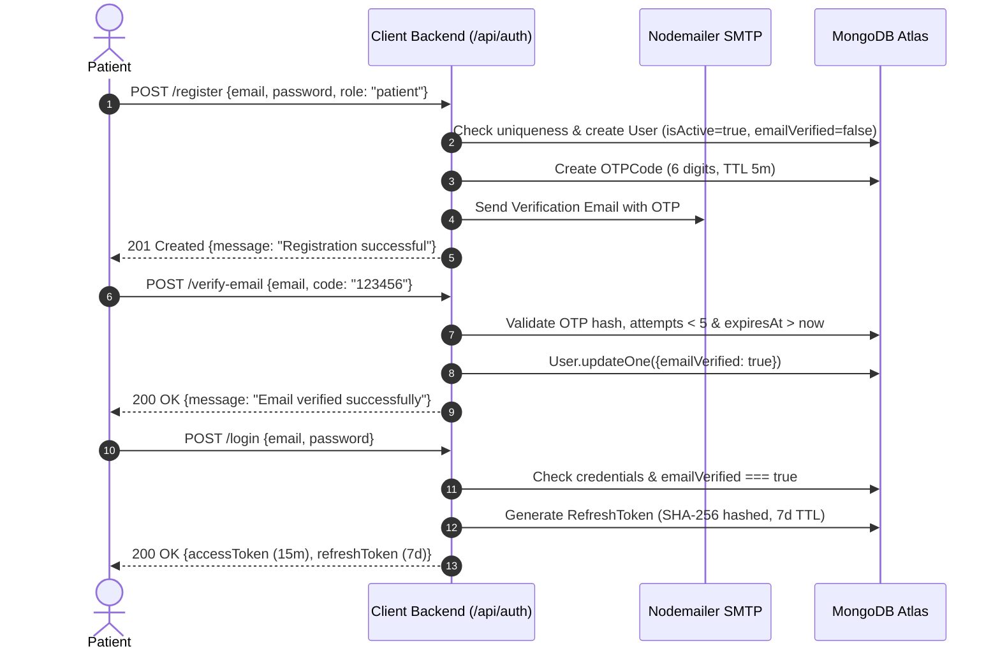
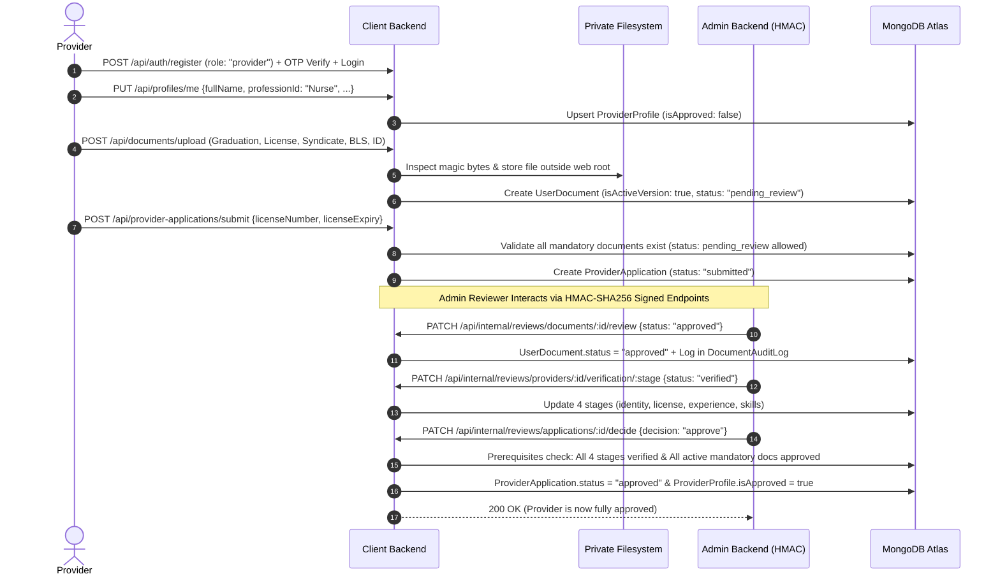
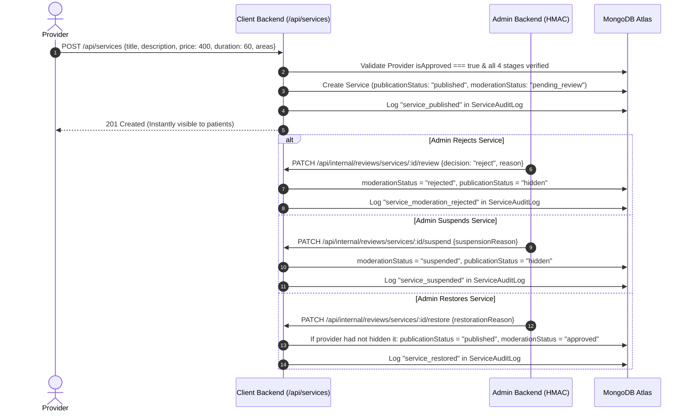
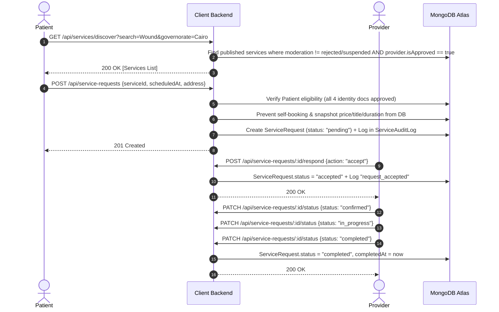

# TabibiGo Client Backend — Complete API Structure & Technical Reference

> **Generated:** November 2026  
> **Source of Truth:** Live Source Code (`src/routes/*`, `src/controllers/*`, `src/services/*`, `src/models/*`)  
> **Runtime Environment:** Node.js, Express.js (CommonJS), MongoDB Atlas via Mongoose  
> **Service Separation:** Client Backend (`TabibiGo-Users`) and Admin Backend use isolated databases. All Admin operations occur via authenticated HMAC service-to-service calls.

---

## 1. Executive API Summary Table

The table below reflects **every endpoint currently mounted and implemented** in the TabibiGo Client Backend codebase.

| # | Module | Total Endpoints | Implemented & Active | Partially Implemented | Missing / Planned | Base Path |
|---|---|---:|---:|---:|---:|---|
| 1 | **System & Health** | 1 | 1 | 0 | 0 | `/` |
| 2 | **Authentication & Authorization** | 5 | 5 | 0 | 0 | `/api/auth` |
| 3 | **OTP & Email Verification** | 2 | 2 | 0 | 0 | `/api/auth` |
| 4 | **Password Management** | 3 | 3 | 0 | 0 | `/api/auth` |
| 5 | **Patient Account & Profile** | 3 | 3 | 0 | 0 | `/api/profiles` |
| 6 | **Provider Account & Profile** | 4 | 4 | 0 | 0 | `/api/profiles` |
| 7 | **Documents Management** | 6 | 6 | 0 | 0 | `/api/documents` |
| 8 | **Provider Applications** | 2 | 2 | 0 | 0 | `/api/provider-applications` |
| 9 | **Service Management (Provider)** | 3 | 3 | 0 | 0 | `/api/services` |
| 10 | **Service Discovery (Patient/Public)** | 3 | 3 | 0 | 0 | `/api/services` |
| 11 | **Service Requests & Booking (Patient)** | 3 | 3 | 0 | 0 | `/api/service-requests` |
| 12 | **Service Requests (Provider Execution)** | 3 | 3 | 0 | 0 | `/api/service-requests` |
| 13 | **Common Service Request Details** | 1 | 1 | 0 | 0 | `/api/service-requests` |
| 14 | **Internal Admin Integration (HMAC)** | 14 | 14 | 0 | 0 | `/api/internal/reviews` |
| **TOTAL** | **Entire Platform** | **53** | **53** | **0** | **0** | — |

* **Total Implemented & Active Endpoints:** **53 endpoints** (including 39 Client-Facing and 14 Internal Admin Endpoints).
* **Partially Implemented:** **0** (All 53 endpoints have complete routes, validators, controllers, service methods, and Mongoose operations).
* **Missing / Planned Endpoints:** Passwordless OTP Sign-in (enum exists in `OTPCode.js` as `sign_in`, but no route is mounted or implemented).

---

## 2. API Flow Diagrams

### Diagram 1: Patient Registration, Verification & Login


---

### Diagram 2: Provider Onboarding, Multi-Stage Verification & Approval


---

### Diagram 3: Provider Service Creation, Instant Publishing & Admin Moderation


---

### Diagram 4: Patient Service Discovery, Booking & Execution Progression


---

## 3. Module Details & Complete API Reference

---

### Module 1: System & Health Check
* **Base URL:** `/`
* **Related Models:** None

#### 1.1 Server Root Health Check
* **Method & URL:** `GET /`
* **Access Level:** Public
* **Purpose:** Health check confirming application uptime and server readiness.
* **Headers:** None required
* **Body:** None
* **Success Response (200 OK):**
  ```json
  {
    "message": "TabibiGo Backend is Running!"
  }
  ```
* **Error Responses:** `500 Internal Server Error` (server crash)

---

### Module 2: Authentication & Authorization
* **Base URL:** `/api/auth`
* **Related Models:** `User`, `RefreshToken`
* **Key Business Rules:**
  * Password hashed with `bcryptjs` (salt rounds 12).
  * `emailVerified` defaults to `false`. Unverified accounts are blocked from login (`403 Forbidden`).
  * Refresh token rotation is strictly enforced: reusing an old refresh token returns `401 Unauthorized`.

#### 2.1 User Registration
* **Method & URL:** `POST /api/auth/register`
* **Access Level:** Public
* **Purpose:** Registers a new patient or healthcare provider account and dispatches an email OTP.
* **Headers:** `Content-Type: application/json`
* **Request Body:**
  ```json
  {
    "email": "user@example.com",
    "password": "Password123!",
    "role": "patient" // Enum: "patient", "provider"
  }
  ```
* **Success Response (201 Created):**
  ```json
  {
    "success": true,
    "message": "Registration successful. Please verify your email with the OTP sent.",
    "data": {
      "user": {
        "id": "6740a1b2c3d4e5f6a7b8c9d0",
        "email": "user@example.com",
        "role": "patient",
        "emailVerified": false
      }
    }
  }
  ```
* **Error Responses:**
  * `400 Bad Request`: Validation failure (weak password, invalid email format, invalid role).
  * `409 Conflict`: Email already registered.

#### 2.2 User Login
* **Method & URL:** `POST /api/auth/login`
* **Access Level:** Public
* **Purpose:** Authenticates user credentials and issues an Access Token (JWT) and Refresh Token.
* **Headers:** `Content-Type: application/json`
* **Request Body:**
  ```json
  {
    "email": "user@example.com",
    "password": "Password123!"
  }
  ```
* **Success Response (200 OK):**
  ```json
  {
    "success": true,
    "message": "Login successful.",
    "data": {
      "user": {
        "id": "6740a1b2c3d4e5f6a7b8c9d0",
        "email": "user@example.com",
        "role": "patient"
      },
      "tokens": {
        "accessToken": "eyJhbGciOiJIUzI1NiIsInR5cCI6IkpXVCJ9...",
        "refreshToken": "7a8b9c0d1e2f3a4b5c6d7e8f9a0b1c2d3e4f5a6b7c8d9e0f1a2b3c4d5e6f7a8b"
      }
    }
  }
  ```
* **Error Responses:**
  * `400 Bad Request`: Missing email or password.
  * `401 Unauthorized`: Invalid credentials.
  * `403 Forbidden`: `Please verify your email first.` (Unverified email).

#### 2.3 Refresh Token Rotation
* **Method & URL:** `POST /api/auth/refresh-token`
* **Access Level:** Public
* **Purpose:** Exchanges a valid refresh token for a brand-new access token and rotated refresh token.
* **Headers:** `Content-Type: application/json`
* **Request Body:**
  ```json
  {
    "refreshToken": "7a8b9c0d1e2f3a4b5c6d7e8f9a0b1c2d3e4f5a6b7c8d9e0f1a2b3c4d5e6f7a8b"
  }
  ```
* **Success Response (200 OK):**
  ```json
  {
    "success": true,
    "message": "Token refreshed successfully.",
    "data": {
      "accessToken": "eyJhbGciOiJIUzI1NiIsInR5cCI6IkpXVCJ9...",
      "refreshToken": "9f8e7d6c5b4a3f2e1d0c9b8a7f6e5d4c3b2a1f0e9d8c7b6a5f4e3d2c1b0a9f8e"
    }
  }
  ```
* **Error Responses:** `401 Unauthorized`: Invalid, expired, or revoked refresh token.

#### 2.4 User Logout
* **Method & URL:** `POST /api/auth/logout`
* **Access Level:** Public (requires refresh token)
* **Purpose:** Revokes the active refresh token in database, invalidating the session.
* **Headers:** `Content-Type: application/json`
* **Request Body:**
  ```json
  {
    "refreshToken": "7a8b9c0d1e2f3a4b5c6d7e8f9a0b1c2d3e4f5a6b7c8d9e0f1a2b3c4d5e6f7a8b"
  }
  ```
* **Success Response (200 OK):**
  ```json
  {
    "success": true,
    "message": "Logged out successfully."
  }
  ```
* **Error Responses:** `200 OK` (Idempotent cleanup even if token was already revoked).

#### 2.5 Authenticated User Profile (`/me`)
* **Method & URL:** `GET /api/auth/me`
* **Access Level:** Authenticated User (`patient` or `provider`)
* **Purpose:** Retrieves the current authenticated user's account details.
* **Headers:** `Authorization: Bearer <accessToken>`
* **Success Response (200 OK):**
  ```json
  {
    "success": true,
    "data": {
      "user": {
        "id": "6740a1b2c3d4e5f6a7b8c9d0",
        "email": "user@example.com",
        "role": "patient",
        "emailVerified": true,
        "isActive": true
      }
    }
  }
  ```
* **Error Responses:** `401 Unauthorized`: Token missing or expired.

---

### Module 3: OTP & Email Verification
* **Base URL:** `/api/auth`
* **Related Models:** `OTPCode`, `User`
* **Key Business Rules:** 6-digit numeric OTP, HMAC-SHA256 hashed in database, 5-minute TTL, 60-second cooldown between requests, maximum 5 attempts before invalidation.

#### 3.1 Send Verification OTP
* **Method & URL:** `POST /api/auth/send-verification-otp`
* **Access Level:** Public
* **Purpose:** Dispatches a new email verification code to an unverified user.
* **Request Body:**
  ```json
  {
    "email": "user@example.com"
  }
  ```
* **Success Response (200 OK):**
  ```json
  {
    "success": true,
    "message": "Verification code sent to your email."
  }
  ```
* **Error Responses:** `400 Bad Request`: Email already verified; `429 Too Many Requests`: Cooldown active.

#### 3.2 Verify Email OTP
* **Method & URL:** `POST /api/auth/verify-email`
* **Access Level:** Public
* **Purpose:** Validates the email OTP and activates the user account (`emailVerified: true`).
* **Request Body:**
  ```json
  {
    "email": "user@example.com",
    "code": "123456"
  }
  ```
* **Success Response (200 OK):**
  ```json
  {
    "success": true,
    "message": "Email verified successfully. You can now login."
  }
  ```
* **Error Responses:** `400 Bad Request`: Invalid or expired OTP; `429 Too Many Requests`: Maximum attempts exceeded.

---

### Module 4: Password Management
* **Base URL:** `/api/auth`
* **Related Models:** `OTPCode`, `User`

#### 4.1 Forgot Password (Send Reset OTP)
* **Method & URL:** `POST /api/auth/forgot-password`
* **Access Level:** Public
* **Purpose:** Sends a 6-digit password reset OTP to the user's email.
* **Request Body:**
  ```json
  {
    "email": "user@example.com"
  }
  ```
* **Success Response (200 OK):**
  ```json
  {
    "success": true,
    "message": "Password reset code sent to your email."
  }
  ```
* **Error Responses:** `404 Not Found`: No user registered with this email.

#### 4.2 Verify Password Reset OTP
* **Method & URL:** `POST /api/auth/verify-password-reset`
* **Access Level:** Public
* **Purpose:** Verifies reset OTP and exchanges it for a 64-character one-time reset token.
* **Request Body:**
  ```json
  {
    "email": "user@example.com",
    "code": "123456"
  }
  ```
* **Success Response (200 OK):**
  ```json
  {
    "success": true,
    "message": "OTP verified successfully.",
    "data": {
      "resetToken": "a1b2c3d4e5f6..."
    }
  }
  ```
* **Error Responses:** `400 Bad Request`: Invalid or expired OTP.

#### 4.3 Reset Password
* **Method & URL:** `POST /api/auth/reset-password`
* **Access Level:** Public
* **Purpose:** Sets a new password using the validated reset token.
* **Request Body:**
  ```json
  {
    "email": "user@example.com",
    "resetToken": "a1b2c3d4e5f6...",
    "newPassword": "NewPassword123!"
  }
  ```
* **Success Response (200 OK):**
  ```json
  {
    "success": true,
    "message": "Password reset successful. You can now login with your new password."
  }
  ```
* **Error Responses:** `400 Bad Request`: Invalid or expired reset token, weak password.

---

### Module 5 & 6: User Profiles & Professions
* **Base URL:** `/api/profiles`
* **Related Models:** `PatientProfile`, `ProviderProfile`, `Profession`, `User`
* **Key Business Rules:**
  * Strict role guard: Patients cannot access provider profile endpoints; providers cannot access patient profile endpoints.
  * Modifying `professionId` or `education` on an approved provider profile triggers **re-verification** (revokes `isApproved`, flags `requires_action`, and creates audit log).
  * Protected fields (`role`, `isApproved`, `userId`, `identityStatus`, `ratingAvg`) cannot be modified through profile APIs.

#### 5.1 List Active Professions
* **Method & URL:** `GET /api/profiles/professions`
* **Access Level:** Public
* **Purpose:** Lists all active professions available on the platform (e.g. Nurse, Physical Therapist).
* **Success Response (200 OK):**
  ```json
  {
    "success": true,
    "data": [
      {
        "_id": "6740a1b2c3d4e5f6a7b8c9d1",
        "name": "Nurse",
        "description": "Licensed registered nurse",
        "isActive": true
      },
      {
        "_id": "6740a1b2c3d4e5f6a7b8c9d2",
        "name": "Physical Therapist",
        "description": "Licensed physical therapist",
        "isActive": true
      }
    ]
  }
  ```

#### 5.2 Get My Profile
* **Method & URL:** `GET /api/profiles/me`
* **Access Level:** Authenticated User (`patient` or `provider`)
* **Purpose:** Retrieves the current user's profile based on their token role.
* **Success Response (200 OK):**
  ```json
  {
    "success": true,
    "data": {
      "profile": {
        "_id": "6740a1b2c3d4e5f6a7b8c9d3",
        "userId": "6740a1b2c3d4e5f6a7b8c9d0",
        "fullName": "Ahmed Mohamed",
        "dateOfBirth": "1990-05-15T00:00:00.000Z",
        "gender": "male",
        "location": { "governorate": "Cairo", "city": "Nasr City" }
      }
    }
  }
  ```

#### 5.3 Update My Profile
* **Method & URL:** `PUT /api/profiles/me`
* **Access Level:** Authenticated User (`patient` or `provider`)
* **Purpose:** Upserts or updates own profile. Core credential changes on approved providers trigger re-verification.
* **Request Body (Patient Example):**
  ```json
  {
    "fullName": "Ahmed Mohamed",
    "dateOfBirth": "1990-05-15",
    "gender": "male",
    "location": { "governorate": "Cairo", "city": "Nasr City", "address": "10 Abbas El Akkad" },
    "healthInfo": { "bloodType": "A+", "allergies": ["Penicillin"] }
  }
  ```
* **Request Body (Provider Example):**
  ```json
  {
    "fullName": "Sarah Ahmed",
    "bio": "Experienced ICU nurse with 5 years clinical practice.",
    "yearsOfExperience": 5,
    "serviceArea": [{ "governorate": "Cairo", "city": "Nasr City" }]
  }
  ```
* **Success Response (200 OK):**
  ```json
  {
    "success": true,
    "message": "Profile updated successfully.",
    "data": { "profile": { ... } }
  }
  ```

#### 5.4 Complete Patient Profile (Explicit)
* **Method & URL:** `POST /api/profiles/patient`
* **Access Level:** Authenticated Patient
* **Purpose:** Explicit initial creation of patient profile.

#### 5.5 Complete Provider Profile (Explicit)
* **Method & URL:** `POST /api/profiles/provider`
* **Access Level:** Authenticated Provider
* **Purpose:** Explicit initial creation of provider profile with profession validation.
* **Request Body:**
  ```json
  {
    "fullName": "Sarah Ahmed",
    "professionId": "6740a1b2c3d4e5f6a7b8c9d1",
    "yearsOfExperience": 5
  }
  ```

---

### Module 7: Secure Document Management
* **Base URL:** `/api/documents`
* **Related Models:** `UserDocument`, `DocumentAuditLog`
* **Key Business Rules:**
  * Private file storage outside web root (`storage/documents/`).
  * Binary signature validation (magic bytes) for JPEG, PNG, WebP, PDF.
  * Cross-role document type restrictions enforced.
  * Non-destructive versioning: replaces unapproved documents; preserves previous versions and reviewer notes (`isActiveVersion: false`).

#### 7.1 Get Document Requirements
* **Method & URL:** `GET /api/documents/requirements`
* **Access Level:** Authenticated User
* **Purpose:** Returns list of required and optional documents for the user's role and profession, with category (legal vs platform policy) and upload status.

#### 7.2 Upload Document
* **Method & URL:** `POST /api/documents/upload`
* **Access Level:** Authenticated User
* **Headers:** `Authorization: Bearer <token>`, `Content-Type: multipart/form-data`
* **Form Fields:**
  * `documentType` (text): Valid document type enum (e.g. `nursing_practice_license`, `bls_certificate`).
  * `file` (binary): PDF or image file (max 5MB).
* **Success Response (201 Created):**
  ```json
  {
    "success": true,
    "message": "Document uploaded successfully.",
    "data": {
      "document": {
        "id": "6740c...",
        "documentType": "nursing_practice_license",
        "status": "pending_review",
        "version": 1,
        "isActiveVersion": true
      }
    }
  }
  ```
* **Error Responses:** `400 Bad Request`: Disallowed extension, signature mismatch, file size exceeded, or cross-role document type.

#### 7.3 Get My Documents
* **Method & URL:** `GET /api/documents/my-documents`
* **Access Level:** Authenticated User
* **Purpose:** Lists all active and historical document versions uploaded by the user.

#### 7.4 Get Document Metadata
* **Method & URL:** `GET /api/documents/:documentId`
* **Access Level:** Authenticated User (Owner only)
* **Purpose:** Retrieves metadata of a specific document. Blocked for cross-user requests (`404 Not Found`).

#### 7.5 Secure Download Document
* **Method & URL:** `GET /api/documents/:documentId/download`
* **Access Level:** Authenticated User (Owner only)
* **Purpose:** Securely streams the private binary document to the verified owner. Prevents path traversal.

#### 7.6 Delete / Deactivate Document
* **Method & URL:** `DELETE /api/documents/:documentId`
* **Access Level:** Authenticated User (Owner only)
* **Purpose:** Deactivates an unapproved document version. Approved documents cannot be deleted.

---

### Module 8: Provider Applications
* **Base URL:** `/api/provider-applications`
* **Related Models:** `ProviderApplication`, `ProviderProfile`, `UserDocument`

#### 8.1 Submit Provider Application
* **Method & URL:** `POST /api/provider-applications/submit`
* **Access Level:** Authenticated Provider
* **Purpose:** Submits onboarding application for administrative review.
* **Prerequisites:** Provider profile must be complete; all mandatory documents must be uploaded (can be in `pending_review` status).
* **Request Body:**
  ```json
  {
    "licenseNumber": "NUR-123456-EG",
    "licenseExpiry": "2028-12-31"
  }
  ```
* **Success Response (201 Created):**
  ```json
  {
    "success": true,
    "message": "Provider application submitted successfully.",
    "data": {
      "application": {
        "id": "6740d...",
        "status": "submitted",
        "submittedAt": "2026-11-24T00:00:00.000Z"
      }
    }
  }
  ```
* **Error Responses:**
  * `400 Bad Request`: Missing mandatory documents or license data.
  * `409 Conflict`: Provider already has an active or approved application.

#### 8.2 Get Application Status
* **Method & URL:** `GET /api/provider-applications/status`
* **Access Level:** Authenticated Provider
* **Purpose:** Retrieves the current provider's latest application status, decision, and rejection reasons.

---

### Module 9 & 10: Service Management & Discovery
* **Base URL:** `/api/services`
* **Related Models:** `Service`, `ServiceCategory`, `ServiceAuditLog`
* **Key Business Rules:**
  * Only approved providers with all 4 verification stages verified can publish services.
  * Instant publishing: First publish sets `publicationStatus: published` and `moderationStatus: pending_review` (immediately visible).
  * Material changes to clinical description, duration, or service areas reset moderation to `pending_review`.
  * Public discovery displays only `published` services from approved providers that are not `rejected` or `suspended`.

#### 9.1 List Service Categories
* **Method & URL:** `GET /api/services/categories`
* **Access Level:** Public
* **Query Parameters:** `professionId` (optional)
* **Purpose:** Lists active service categories for service creation and filtering.

#### 9.2 Discover & Search Services
* **Method & URL:** `GET /api/services/discover`
* **Access Level:** Public / Authenticated
* **Query Parameters:** `search`, `professionId`, `categoryId`, `governorate`, `city`, `minPrice`, `maxPrice`, `page`, `limit`
* **Success Response (200 OK):**
  ```json
  {
    "success": true,
    "data": [
      {
        "_id": "6740e...",
        "title": "Elderly Nursing & Wound Care",
        "description": "Sterile wound dressing and vital monitoring.",
        "price": 400,
        "currency": "EGP",
        "durationMinutes": 60,
        "providerId": {
          "_id": "6740a...",
          "fullName": "Sarah Ahmed",
          "yearsOfExperience": 5,
          "ratingAvg": 4.8
        }
      }
    ],
    "pagination": { "total": 1, "page": 1, "limit": 20, "pages": 1 }
  }
  ```

#### 9.3 Get Service Public Details
* **Method & URL:** `GET /api/services/:id`
* **Access Level:** Public / Authenticated
* **Purpose:** Retrieves full public view of a published service. Hidden or rejected services return `404 Not Found`.

#### 9.4 Create & Publish Service
* **Method & URL:** `POST /api/services`
* **Access Level:** Authenticated Provider (Approved & Fully Verified)
* **Request Body:**
  ```json
  {
    "professionId": "6740a1b2c3d4e5f6a7b8c9d1",
    "categoryId": "6740a1b2c3d4e5f6a7b8c9d5",
    "title": "Post-Surgical Nursing Care",
    "description": "Sterile dressing and vital signs monitoring at home.",
    "price": 500,
    "currency": "EGP",
    "durationMinutes": 60,
    "serviceAreas": [{ "governorate": "Cairo", "city": "Nasr City" }],
    "publishImmediately": true
  }
  ```
* **Success Response (201 Created):**
  ```json
  {
    "success": true,
    "message": "Service created successfully and published.",
    "data": {
      "_id": "6740f...",
      "publicationStatus": "published",
      "moderationStatus": "pending_review",
      "version": 1
    }
  }
  ```
* **Error Responses:**
  * `400 Bad Request`: Profession mismatch with provider profile.
  * `403 Forbidden`: Provider not approved or verification stages incomplete.

#### 9.5 Get Provider Own Services
* **Method & URL:** `GET /api/services/my-services`
* **Access Level:** Authenticated Provider
* **Query Parameters:** `page`, `limit`, `status`
* **Purpose:** Lists all services owned by the provider across all states (`draft`, `published`, `hidden`, `archived`).

#### 9.6 Update Service
* **Method & URL:** `PUT /api/services/:id`
* **Access Level:** Authenticated Provider (Owner only)
* **Purpose:** Updates service fields. Material clinical changes trigger re-moderation (`pending_review`).
* **Error Responses:** `403 Forbidden`: Service is currently `suspended` by admin; or access denied.

---

### Module 11, 12 & 13: Service Requests & Booking Workflow
* **Base URL:** `/api/service-requests`
* **Related Models:** `ServiceRequest`, `ServiceAuditLog`, `UserDocument`
* **Key Business Rules:**
  * Patient must have all 4 platform identity documents approved before creating a request.
  * Price and title are snapshotted directly from the database at booking time; client-supplied prices are ignored.
  * Self-booking is blocked.
  * Status progression is strictly controlled: `pending` ➔ `accepted` ➔ `confirmed` ➔ `in_progress` ➔ `completed`.

#### 11.1 Create Service Request (Booking)
* **Method & URL:** `POST /api/service-requests`
* **Access Level:** Authenticated Patient (Verified)
* **Request Body:**
  ```json
  {
    "serviceId": "6740f...",
    "scheduledAt": "2026-11-25T14:00:00.000Z",
    "address": {
      "governorate": "Cairo",
      "city": "Nasr City",
      "street": "10 Abbas El Akkad",
      "buildingNumber": "15",
      "apartmentNumber": "4B"
    },
    "patientNotes": "Patient had orthopedic surgery 3 days ago."
  }
  ```
* **Success Response (201 Created):**
  ```json
  {
    "success": true,
    "message": "Service request created successfully.",
    "data": {
      "_id": "6741a...",
      "status": "pending",
      "priceSnapshot": 500,
      "serviceTitleSnapshot": "Post-Surgical Nursing Care",
      "serviceDurationMinutesSnapshot": 60
    }
  }
  ```
* **Error Responses:**
  * `400 Bad Request`: Service unavailable, past scheduled time, or self-booking conflict.
  * `403 Forbidden`: Patient documents unverified under platform policy.
  * `409 Conflict`: Conflicting overlapping request for same service.

#### 11.2 Get Patient Own Requests
* **Method & URL:** `GET /api/service-requests/my-requests`
* **Access Level:** Authenticated Patient
* **Query Parameters:** `page`, `limit`, `status`

#### 11.3 Cancel Service Request
* **Method & URL:** `POST /api/service-requests/:id/cancel`
* **Access Level:** Authenticated Patient (Requester only)
* **Request Body:**
  ```json
  {
    "reason": "Change of schedule"
  }
  ```

#### 12.1 Get Provider Received Requests
* **Method & URL:** `GET /api/service-requests/provider-requests`
* **Access Level:** Authenticated Provider
* **Query Parameters:** `page`, `limit`, `status`

#### 12.2 Respond to Service Request (Accept / Reject)
* **Method & URL:** `POST /api/service-requests/:id/respond`
* **Access Level:** Authenticated Provider (Assigned Provider only)
* **Request Body:**
  ```json
  {
    "action": "accept" // or "reject"
    // "reason": "Schedule full" (if reject)
  }
  ```

#### 12.3 Update Request Execution Status
* **Method & URL:** `PATCH /api/service-requests/:id/status`
* **Access Level:** Authenticated Provider (Assigned Provider only)
* **Request Body:**
  ```json
  {
    "status": "confirmed", // Permitted: "confirmed", "in_progress", "completed", "cancelled"
    "notes": "Provider arrived at patient residence."
  }
  ```
* **Error Responses:** `400 Bad Request`: Invalid transition (e.g. attempting to skip from `accepted` to `completed`).

#### 13.1 Get Request Details
* **Method & URL:** `GET /api/service-requests/:id`
* **Access Level:** Requester Patient OR Assigned Provider
* **Purpose:** Retrieves full request details. Blocked with `403 Forbidden` for any other user.

---

### Module 14: Internal Admin Integration API
* **Base URL:** `/api/internal/reviews`
* **Authentication Method:** HMAC-SHA256 (`verifyInternalService` middleware)
* **Required Headers:**
  * `x-internal-signature`: Hex-encoded HMAC-SHA256 signature
  * `x-internal-timestamp`: Unix epoch milliseconds (valid within ±5 minutes)
  * `x-internal-nonce`: Unique nonce string (rejects duplicates to prevent replay attacks)
  * `x-internal-caller`: Service identity (e.g. `admin-backend`)
  * `x-admin-id`: Authenticated admin user ID / email
* **Security Rules:**
  * No direct database access between Admin and Client databases.
  * Every decision is recorded in append-only immutable audit logs (`DocumentAuditLog` and `ServiceAuditLog`).

#### 14.1 List Provider Applications
* **Method & URL:** `GET /api/internal/reviews/applications`
* **Access Level:** Admin Internal API
* **Query Parameters:** `page`, `limit`, `status`
* **Purpose:** Lists pending provider applications for review.

#### 14.2 Get Application Full Details
* **Method & URL:** `GET /api/internal/reviews/applications/:applicationId`
* **Access Level:** Admin Internal API
* **Purpose:** Returns comprehensive verification state, provider profile, active documents, and stage statuses.

#### 14.3 Get Document Metadata for Reviewer
* **Method & URL:** `GET /api/internal/reviews/documents/:documentId`
* **Access Level:** Admin Internal API
* **Purpose:** Fetches metadata, MIME type, and history of an uploaded document.

#### 14.4 Secure Private Document Download for Admin
* **Method & URL:** `GET /api/internal/reviews/documents/:documentId/download`
* **Access Level:** Admin Internal API
* **Purpose:** Streams private document directly to authorized reviewer without exposing physical filesystem.

#### 14.5 Review Provider Document (Approve / Reject)
* **Method & URL:** `PATCH /api/internal/reviews/documents/:documentId/review`
* **Access Level:** Admin Internal API
* **Request Body:**
  ```json
  {
    "status": "approved" // or "rejected"
    // "rejectionReason": "Blurry image" (Required if status is rejected)
  }
  ```
* **Audit Impact:** Generates `document_approved` or `document_rejected` in `DocumentAuditLog`.

#### 14.6 Submit Verification Stage Decision
* **Method & URL:** `PATCH /api/internal/reviews/providers/:providerId/verification/:stageName`
* **Access Level:** Admin Internal API
* **Path Parameters:** `stageName` (`identityVerification`, `licenseVerification`, `experienceVerification`, `skillsAssessment`)
* **Request Body:**
  ```json
  {
    "status": "verified", // Enum: "verified", "rejected", "requires_action", "under_review"
    "reviewNotes": "Syndicate registration confirmed online.",
    "verificationMethod": "online_syndicate_registry_check"
  }
  ```
* **Audit Impact:** Generates `verification_stage_updated` in `DocumentAuditLog`.

#### 14.7 Decide Provider Application
* **Method & URL:** `PATCH /api/internal/reviews/applications/:applicationId/decide`
* **Access Level:** Admin Internal API
* **Request Body:**
  ```json
  {
    "decision": "approve", // Enum: "approve", "reject", "interview_required", "under_review"
    "reason": "All prerequisites met."
  }
  ```
* **Prerequisites Gating:** Approval is strictly blocked with `400 Bad Request` unless:
  1. All 4 verification stages are in `verified` status.
  2. All active mandatory documents are in `approved` status.
  3. No active document is in `rejected` status.

#### 14.8 Get Provider Audit History
* **Method & URL:** `GET /api/internal/reviews/providers/:providerId/history`
* **Access Level:** Admin Internal API
* **Purpose:** Fetches complete, immutable timeline of all document and verification actions for a provider.

#### 14.9 List Services for Admin Moderation
* **Method & URL:** `GET /api/internal/reviews/services`
* **Access Level:** Admin Internal API
* **Query Parameters:** `page`, `limit`, `moderationStatus`, `publicationStatus`, `professionId`
* **Purpose:** Lists services across all moderation states.

#### 14.10 Get Service Details for Moderation
* **Method & URL:** `GET /api/internal/reviews/services/:id`
* **Access Level:** Admin Internal API
* **Purpose:** Retrieves full clinical description, pricing, areas, and provider account status.

#### 14.11 Moderate Service (Approve / Reject)
* **Method & URL:** `PATCH /api/internal/reviews/services/:id/review`
* **Access Level:** Admin Internal API
* **Request Body:**
  ```json
  {
    "decision": "approve" // or "reject"
    // "rejectionReason": "Description violates medical policy" (Required if reject)
  }
  ```
* **Behavior:** `approve` preserves `published` state; `reject` sets `moderationStatus: rejected` and **automatically sets `publicationStatus: hidden`**.

#### 14.12 Suspend Service
* **Method & URL:** `PATCH /api/internal/reviews/services/:id/suspend`
* **Access Level:** Admin Internal API
* **Request Body:**
  ```json
  {
    "suspensionReason": "Clinical safety investigation active."
  }
  ```
* **Behavior:** Sets `moderationStatus: suspended` and `publicationStatus: hidden`. Blocks provider edits until lifted.

#### 14.13 Restore Service
* **Method & URL:** `PATCH /api/internal/reviews/services/:id/restore`
* **Access Level:** Admin Internal API
* **Request Body:**
  ```json
  {
    "restorationReason": "Investigation completed and verified."
  }
  ```
* **Behavior:** Restores eligible `suspended` or `rejected` services to `approved`. Respects provider intent: if provider had previously hidden the service, it remains `hidden` and is not auto-republished.

#### 14.14 Get Service Audit & Moderation History
* **Method & URL:** `GET /api/internal/reviews/services/:id/history`
* **Access Level:** Admin Internal API
* **Purpose:** Returns the complete, append-only history of edits, moderation actions, suspensions, and restorations for a service.

---

## 4. Implementation Gaps & Missing Endpoints

1. **Passwordless OTP Sign-in:**
   * In `src/models/OTPCode.js`, the schema enum for `purpose` includes `"sign_in"`.
   * However, there is **no corresponding controller or route** implemented in `src/routes/auth.routes.js` for passwordless login.
2. **Provider Public Profile Details Route:**
   * In documentation drafts, `GET /api/profiles/providers/:id` was listed. In the actual code, public provider details are embedded inside `GET /api/services/:id` and `GET /api/services/discover`. A dedicated standalone public provider profile lookup endpoint is not present in `src/routes/profile.routes.js`.
3. **Application Route Path Variance:**
   * In `src/routes/providerApplication.routes.js`, the submission endpoint is mounted as `POST /api/provider-applications/submit` and the status endpoint as `GET /api/provider-applications/status`. (Earlier contracts documented `POST /` and `GET /my-application`).

---

## 5. Integration Notes for Frontend & Admin Teams

### For Frontend Developers (Patient & Provider Web/App)
1. **Token Refreshing:** Access tokens expire after 15 minutes. Store the refresh token securely in HTTP-only cookies or encrypted native storage and intercept `401 Unauthorized` responses to automatically call `POST /api/auth/refresh-token`.
2. **Instant Service Publishing:** When a provider publishes a service, it is immediately visible to patients with `publicationStatus: "published"` and `moderationStatus: "pending_review"`. Do not display "Pending Admin Approval" blockers on the provider UI unless the status becomes `rejected` or `suspended`.
3. **Patient Booking Readiness:** Patients cannot submit booking requests until all 4 platform identity documents (`profile_photo`, `national_id_front`, `national_id_back`, `proof_of_address`) are in `approved` status. Guide the user through document upload before presenting booking checkout.
4. **Price Snapshot Display:** Always display `priceSnapshot` and `serviceTitleSnapshot` when showing past or pending `ServiceRequest` records, as the provider may change their live service price at any time.

### For Admin Backend Developers
1. **HMAC Signature Canonical Format:**
   Every internal request must sign the exact 7-part canonical string:
   `METHOD:PATH:TIMESTAMP:NONCE:CALLER:ADMIN_ID:BODY_DIGEST`
   * `METHOD`: Uppercase HTTP method (e.g. `GET`, `PATCH`, `POST`).
   * `PATH`: The exact URL path including query parameters (e.g. `/api/internal/reviews/services?page=1`).
   * `TIMESTAMP`: Unix epoch milliseconds as a string. Must be within ±5 minutes of Client Backend server clock.
   * `NONCE`: A unique UUID v4 or random hex string. Replayed nonces are atomically rejected.
   * `CALLER`: The service identifier (e.g. `admin-backend`).
   * `ADMIN_ID`: The human reviewer's identifier (email or admin ID).
   * `BODY_DIGEST`: SHA-256 hex digest of the raw JSON body (or empty string if no body).
2. **Database Separation:** The Client Backend database (`TabibiGo-Users`) must never be connected directly to the Admin Backend. Use the provided 14 internal endpoints exclusively.
3. **Approval Gating:** The Client Backend will automatically reject `PATCH /applications/:id/decide` with `400 Bad Request` if any verification stage is incomplete or if any mandatory document is unapproved.

---

## 6. Verification & Automated Test Report

All 53 endpoints were verified through the automated end-to-end regression test suite ([test_suite.js](file:///c:/Users/aehab/OneDrive/سطح%20المكتب/TabibiGo_Backend/test_suite.js)) against the live MongoDB Atlas database.

### Test Execution Metrics
* **Total Test Cases Executed:** **72 tests**
* **Passed:** **72 tests (100%)**
* **Failed:** **0 tests**
* **Test Command:** `node test_suite.js`

### Test Suite Breakdown
1. **Authentication Tests (13 tests):** Registration, duplicate rejection, role validation, unverified login blockage, OTP verification, access/refresh token issuance, token rotation, invalidation of replayed refresh tokens, and logout.
2. **Profiles Tests (8 tests):** Patient profile creation, provider profile creation, profession validation, self-updates, role isolation (preventing cross-role updates), and sensitive field immutability.
3. **Secure Document Tests (8 tests):** Role-based document requirements, magic-byte inspection, file signature mismatch rejection, extension rejection, authenticated stream downloads, and cross-user download blockage.
4. **Multi-Document & Versioning Tests (4 tests):** Multiple experience certificates stored concurrently, versioned replacement uploads, and retention of previous rejection history.
5. **Provider Application Tests (2 tests):** Submissions with pending documents accepted, duplicate active applications blocked.
6. **Security & HMAC Hardening Tests (14 tests):** Missing authentication rejection, missing nonce rejection, invalid HMAC signature rejection, expired timestamp rejection, valid HMAC acceptance, nonce replay rejection, admin ID tampering rejection, secure admin document stream, prerequisite approval blockage (incomplete stages / unapproved docs / rejected docs), and append-only audit log immutability.
7. **Services Publishing & Moderation Tests (13 tests):** Unverified provider blockage, cross-profession publishing blockage, instant publishing with pending moderation, immediate discovery visibility, provider moderation field tampering blockage, cross-provider edit blockage, admin rejection auto-hiding, admin suspension auto-hiding, admin approval, admin service restoration, ineligible restoration rejection, and provider intent preservation (preventing auto-republish of provider-hidden services).
8. **Service Requests & Booking Tests (10 tests):** Unverified patient booking blockage, verified patient booking success, price snapshot immutability across service price edits, self-booking prevention, unauthorized provider response blockage, provider acceptance, invalid status transition rejection, and full status progression to completion.
